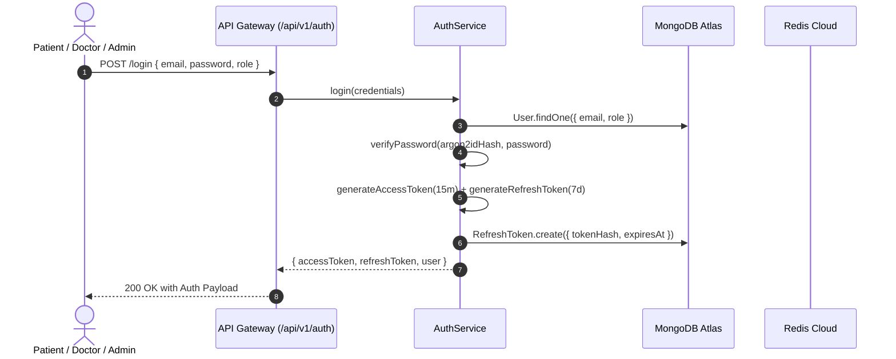

# HealthMate AI — Authentication & RBAC Documentation

**Document Version:** 1.0.0  
**Phase:** Phase 3 — Backend Infrastructure, Database & Security  
**Password Hash Standard:** Argon2id (Memory: 64MB, Iterations: 3, Parallelism: 1)  
**Token Standard:** Dual-Token Pattern (Short-lived JWT Access Token + Rotating Refresh Token)  
**Roles Enforced:** Exactly 3 Roles (`PATIENT`, `DOCTOR`, `ADMINISTRATION`)

---

## 1. Authentication Lifecycle



---

## 2. Argon2id Password Hashing Specification

All passwords are cryptographically hashed using **Argon2id**, the state-of-the-art password hashing winner of the Password Hashing Competition (PHC):

- **Algorithm:** `argon2id` (hybrid of Argon2d and Argon2i, resistant to GPU cracking and side-channel timing attacks)
- **Memory Cost:** `65536` (64 MB of RAM per hash operation)
- **Time Cost:** `3` iterations
- **Parallelism:** `1` thread
- **Output:** Stored in `User.passwordHash` starting with `$argon2id$v=19$m=65536,t=3,p=1$...`

---

## 3. Dual-Token Management & Refresh Token Rotation

1. **Access Token:**
   - Lifetime: 15 minutes
   - Signed with `JWT_ACCESS_SECRET` (minimum 64-character entropy)
   - Carried in `Authorization: Bearer <token>`
2. **Refresh Token:**
   - Lifetime: 7 days
   - Stored in database as a **SHA-256 hash** (`RefreshToken.tokenHash`)
   - Rotated upon every refresh: the old token is revoked (`isRevoked: true`), and a new pair is issued.
   - **Reuse Detection:** If an already-revoked refresh token is presented, all refresh tokens for that user are immediately invalidated, mitigating token theft attacks.

---

## 4. Role-Based Access Control (RBAC) Enforcement

The backend strictly enforces authorization at the HTTP route level using the `requireRoles` middleware:

```javascript
// Example: Only DOCTOR can issue a prescription
router.post('/prescriptions', authenticateToken, requireRoles(['DOCTOR']), prescriptionController.createPrescription);
```

| Role | Access Privileges |
| :--- | :--- |
| **PATIENT** | Profile management, booking appointments, viewing own prescriptions, logging vitals, ephemeral session purge (`/forget-me`). |
| **DOCTOR** | Managing clinical profile, setting availability schedules, conducting consultations, issuing digitally signed prescriptions, viewing consented reports. |
| **ADMINISTRATION** | System overview telemetry, reviewing doctor NMC verification requests, audit logs export, managing hospital directory records, MLOps telemetry. |

> [!WARNING]
> No public registration is permitted for the `ADMINISTRATION` role. Administrative accounts are strictly provisioned by system architects.
