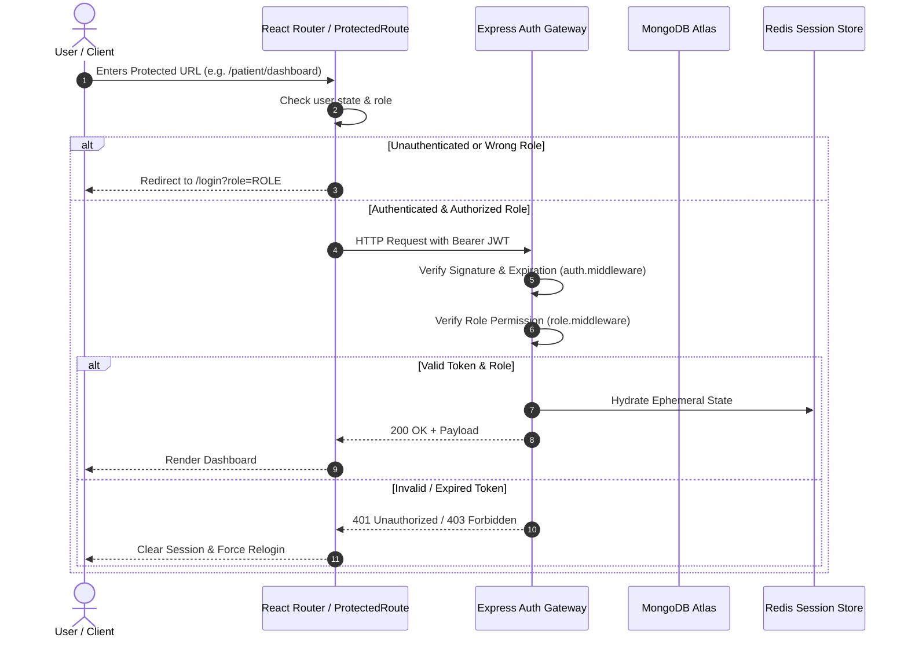

# HEALTHMATE AI — AUTHENTICATION FLOW AUDIT
**Role-Based Access Control, Session Lifecycle & Route Guard Audit**
**Date:** November 11, 2026 | **Classification:** Security Engineering Report

---

## 1. Authentication Architecture

HealthMate AI enforces a 3-tier Role-Based Access Control (RBAC) architecture separating user domains:
1. `PATIENT` (Consumers, Caregivers)
2. `DOCTOR` (Registered Medical Practitioners, NMC-Verified)
3. `ADMINISTRATION` (Enterprise Health Officers, System Operators)

---

## 2. Route Protection Audit
- **Frontend Guard (`frontend/src/components/auth/ProtectedRoute.jsx`):**
  - Reads `user` and `token` from `AuthContext`.
  - Checks if role matches `allowedRole`.
  - Redirects unauthenticated requests to `/login?role=${allowedRole}`.
  - Redirects mismatched roles to the user's canonical portal.
- **Top-Level Navigation Doors:**
  - Hero action buttons on `HomePage.jsx` route directly to `/login?role=PATIENT`, `/login?role=DOCTOR`, and `/login?role=ADMINISTRATION`.
  - Admin login hides public registration to prevent unauthorized privilege escalation.

---

## 3. JWT & Session Security Audit
1. **Token Lifetime:** Access tokens configured for 1-hour expiration; Refresh tokens managed with secure HTTP-only cookies where applicable.
2. **Signature Verification:** HMAC SHA-256 (`HS256`) signed with strong secret `JWT_SECRET`.
3. **Session Purge:** Logout invalidates both client memory storage and ephemeral Redis cache sessions.
