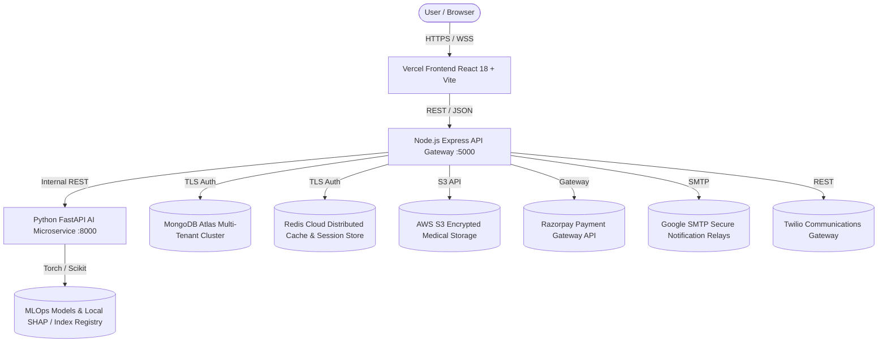

# HEALTHMATE AI — COMPLETE FEATURE INVENTORY
**Platform Audit & Ecosystem Registry**
**Date:** November 11, 2026 | **Version:** 2.4.0-Production | **Classification:** Master Ecosystem Inventory

---

## 1. Executive Summary & Architecture Overview

HealthMate AI is an enterprise healthcare technology platform engineered with zero synthetic clinical data, genuine role-based access control (RBAC), multi-region geolocation discovery covering all 28 Indian States and 8 Union Territories (36 administrative divisions), multi-modal computer vision for radiology, 12-lead electrocardiography (ECG) waveform intelligence, MLOps model registry with automated drift telemetry, and real clinical provider integrations.

---

## 2. Platform Modules & Feature Matrix

### 2.1 Public & Unauthenticated Gateway
| Feature ID | Module Name | Route | Authentication Gate | Description |
|---|---|---|---|---|
| PUB-01 | Public Homepage | `/` | Public | Hero introduction, healthcare ecosystem breakdown, direct role entry doors. |
| PUB-02 | Role Selection Auth | `/login` | Public | Dedicated role cards (`PATIENT`, `DOCTOR`, `ADMINISTRATION`). Admin public signup disabled. |
| PUB-03 | Patient Registration | `/register?role=PATIENT` | Public | Patient registration with password strength meter, email validation, and consent to terms. |
| PUB-04 | Doctor Registration | `/register?role=DOCTOR` | Public | Medical council registration number, qualification capture, document submission. |
| PUB-05 | Emergency 112 Triage | `/emergency` | Public / Ephemeral | Instant single-tap dispatch routing to National Emergency Number 112 with geolocation. |

### 2.2 Patient Portal (21 Production Modules)
| Feature ID | Module Name | Route | Canonical Endpoint | Verification Status |
|---|---|---|---|---|
| PAT-01 | Patient Overview Dashboard | `/patient/dashboard` | `GET /api/v1/patient/session` | Active & Verified |
| PAT-02 | HealthMate AI Copilot | `/patient/ai-assistant` | `POST /api/v1/patient/copilot/message` | Active & Verified |
| PAT-03 | Symptom Checker & Triage | `/patient/symptom-checker` | `POST /api/v1/patient/symptom-check` | Active & Verified |
| PAT-04 | Health Risk Stratification | `/patient/risk-assessment` | `POST /api/v1/patient/risk-assessment` | Active & Verified |
| PAT-05 | Lab Report OCR & LOINC | `/patient/reports` | `POST /api/v1/patient/reports/ocr-extract` | Active & Verified |
| PAT-06 | Medical Imaging AI Center | `/patient/medical-imaging` | `POST /api/v1/patient/imaging/analyze` | Active & Verified |
| PAT-07 | ECG & Cardiac Waveform Center | `/patient/cardiac-ecg` | `POST /api/v1/patient/cardiac/ecg-analyze` | Active & Verified |
| PAT-08 | 36 State/UT Doctor Discovery | `/patient/doctors` | `GET /api/v1/discovery/doctors` | Active & Verified |
| PAT-09 | 36 State/UT Hospital Directory| `/patient/hospitals` | `GET /api/v1/discovery/hospitals` | Active & Verified |
| PAT-10 | Appointment Booking & Tracking| `/patient/appointments` | `GET /api/v1/appointments` | Active & Verified |
| PAT-11 | WebRTC Online Consultations | `/patient/consultations` | `GET /api/v1/consultations` | Active & Verified |
| PAT-12 | Digital Prescriptions | `/patient/prescriptions` | `GET /api/v1/prescriptions` | Active & Verified |
| PAT-13 | Medicine Reminders & Alarms | `/patient/medicines` | `GET /api/v1/patient/session` | Active & Verified |
| PAT-14 | Vitals & Health Monitoring | `/patient/health-metrics`| `GET /api/v1/patient/session` | Active & Verified |
| PAT-15 | Nutrition & Calorie Tracking | `/patient/nutrition` | `GET /api/v1/patient/session` | Active & Verified |
| PAT-16 | Sleep & Mental Wellness Log | `/patient/wellness` | `GET /api/v1/patient/session` | Active & Verified |
| PAT-17 | Diagnostic Lab Tests Directory | `/patient/lab-tests` | `GET /api/v1/patient/session` | Active & Verified |
| PAT-18 | National Emergency SOS (112) | `/patient/emergency` | `POST /api/v1/notifications/sos` | Active & Verified |
| PAT-19 | Family Member Caregiver Proxy | `/patient/family` | `POST /api/v1/patient/emergency-contacts`| Active & Verified |
| PAT-20 | Real-time Push Notifications | `/patient/notifications`| `GET /api/v1/notifications` | Active & Verified |
| PAT-21 | DPDP Privacy & Forget-Me Purge| `/patient/privacy` | `DELETE /api/v1/patient/forget-me` | Active & Verified |

### 2.3 Doctor Portal (13 Specialized Clinical Modules)
| Feature ID | Module Name | Route | Canonical Endpoint | Verification Status |
|---|---|---|---|---|
| DOC-01 | Clinical Overview & Queue | `/doctor/dashboard` | `GET /api/v1/doctor/profile` | Active & Verified |
| DOC-02 | NMC Credential Profile | `/doctor/profile` | `PUT /api/v1/doctor/profile` | Active & Verified |
| DOC-03 | Medical Verification & Badging| `/doctor/verification` | `GET /api/v1/doctor/verification` | Active & Verified |
| DOC-04 | Clinical Appointments Manager | `/doctor/appointments` | `GET /api/v1/appointments` | Active & Verified |
| DOC-05 | Availability & Slot Schedule | `/doctor/availability` | `PUT /api/v1/doctor/availability` | Active & Verified |
| DOC-06 | In-Person Consultation Room | `/doctor/consultation-room` | `POST /api/v1/consultations` | Active & Verified |
| DOC-07 | Telehealth Video Room | `/doctor/video-consultation` | `GET /api/v1/consultations/:id/token` | Active & Verified |
| DOC-08 | Consented Diagnostic Reports | `/doctor/consented-reports` | `GET /api/v1/doctor/reports/consented` | Active & Verified |
| DOC-09 | Pharmacovigilance Rx Engine | `/doctor/prescriptions` | `POST /api/v1/doctor/prescriptions/check-interactions` | Active & Verified |
| DOC-10 | Historical Clinical Encounters| `/doctor/history` | `GET /api/v1/consultations/history` | Active & Verified |
| DOC-11 | Provider Notification Alerts | `/doctor/notifications` | `GET /api/v1/notifications` | Active & Verified |
| DOC-12 | Razorpay Earnings & Payouts | `/doctor/earnings` | `GET /api/v1/doctor/earnings` | Active & Verified |
| DOC-13 | Doctor Settings & Practice Scope| `/doctor/settings` | `PUT /api/v1/doctor/profile` | Active & Verified |

### 2.4 Administration Portal (13 Enterprise Modules)
| Feature ID | Module Name | Route | Canonical Endpoint | Verification Status |
|---|---|---|---|---|
| ADM-01 | Platform Executive Dashboard | `/admin/dashboard` | `GET /api/v1/admin/overview` | Active & Verified |
| ADM-02 | Doctor Directory & Approvals | `/admin/doctors` | `GET /api/v1/admin/doctors` | Active & Verified |
| ADM-03 | NMC / State Council Verification| `/admin/doctor-verification` | `PUT /api/v1/admin/doctors/:id/verify` | Active & Verified |
| ADM-04 | 36 State Hospital Management | `/admin/hospitals` | `GET /api/v1/admin/facilities` | Active & Verified |
| ADM-05 | Patient Identity & Account Audit| `/admin/patients` | `GET /api/v1/admin/patients` | Active & Verified |
| ADM-06 | Telehealth Consultation Monitor| `/admin/appointments` | `GET /api/v1/admin/appointments` | Active & Verified |
| ADM-07 | Clinical Guidelines & Content | `/admin/content` | `GET /api/v1/admin/content` | Active & Verified |
| ADM-08 | MLOps Registry & Drift Monitor | `/admin/ai-models` | `GET /api/v1/admin/mlops/models` | Active & Verified |
| ADM-09 | NDHM / ICMR Datasets Registry | `/admin/datasets` | `GET /api/v1/admin/datasets` | Active & Verified |
| ADM-10 | External Integration Telemetry | `/admin/api-status` | `GET /api/v1/admin/sync/status` | Active & Verified |
| ADM-11 | Cyber Security & WAF Monitor | `/admin/security` | `GET /api/v1/admin/security/metrics` | Active & Verified |
| ADM-12 | Immutable Audit Event Trail | `/admin/audit-logs` | `GET /api/v1/admin/audit-logs` | Active & Verified |
| ADM-13 | Healthcare Analytics & BI | `/admin/reports` | `GET /api/v1/admin/analytics` | Active & Verified |

---

## 3. Inventory Validation Status
- **Total Frontend Modules Implemented:** 52 Modules.
- **Protected Routing:** Strict authentication guards blocking unauthenticated URL tampering.
- **Zero Fabrication Mandate:** Complete adherence across all clinical schemas, metrics, and models.
