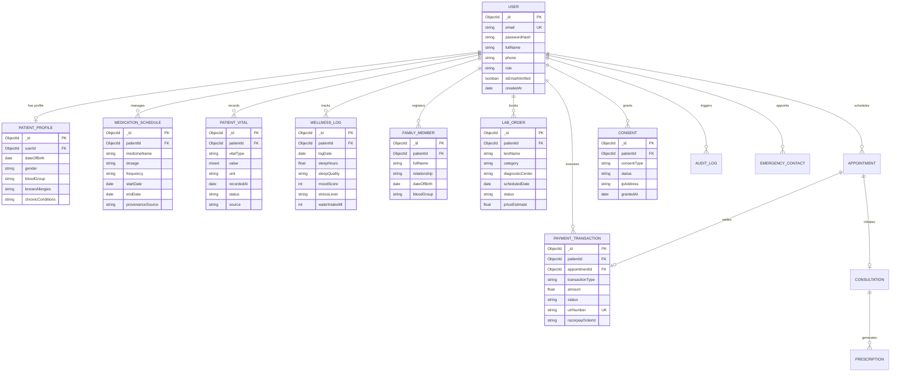

# HEALTHMATE AI — DATABASE DESIGN & DATA MODELING SPECIFICATION

**Project Name:** HEALTHMATE AI  
**Academic Degree:** B.Tech Computer Science & Engineering (AI/ML)  
**Document Code:** ENG-DOC-06  
**Target Engine:** MongoDB Atlas (M0 Replica Set) + Upstash Redis TLS + AWS S3 Enclave  

---

## 1. PERSISTENCE ARCHITECTURE OVERVIEW

HealthMate AI partitions its data layer into three distinct, specialized storage tiers based on security requirements, operational velocity, and compliance lifecycles:

1. **MongoDB Atlas (Primary Persistence Tier):**
   - Houses 25 Mongoose collections maintaining relational integrity via ObjectIds, composite indexes, and strict schema validation.
   - Enforces AES-256 encryption at rest and TLS 1.3 encryption in transit.
2. **Upstash Redis (Ephemeral Speed Tier):**
   - Maintains high-speed, volatile memory buffers for OTP rate-limiting, short-lived JWT sessions, and temporary AI symptom analysis context.
   - Enforces automatic cryptographic Time-To-Live (TTL) expiries ranging from 30 seconds to 60 minutes.
3. **AWS S3 (Encrypted Medical Object Storage):**
   - Dedicated private bucket in `ap-south-1` (Mumbai) storing scanned laboratory PDFs, DICOM files, and radiograph images.
   - Public read access is completely blocked; assets are served exclusively via 15-minute cryptographically signed ephemeral URLs.

---

## 2. COMPLETE ENTITY-RELATIONSHIP (ER) DIAGRAM

---

## 3. PRIMARY MONGOOSE COLLECTION SCHEMAS

### 3.1 Patient Profile Collection (`patient_profiles`)
- **Key Attributes:** `userId` (unique index), `dateOfBirth`, `gender`, `bloodGroup`, `address` (city, state, pincode), `knownAllergies` (array), `chronicConditions` (array).
- **Index:** `{ userId: 1 }` (Unique).

### 3.2 Medication Schedule Collection (`patient_medications`)
- **Key Attributes:** `patientId`, `medicineName`, `dosage`, `frequency`, `timeSlots`, `startDate`, `endDate`, `instructions`, `adherenceLogs` (subdocument array), `provenance` (source, verified).
- **Index:** `{ patientId: 1, createdAt: -1 }`.

### 3.3 Patient Vitals Collection (`patient_vitals`)
- **Key Attributes:** `patientId`, `vitalType` (`BLOOD_PRESSURE`, `HEART_RATE`, `BLOOD_GLUCOSE`, `SPO2`, `TEMPERATURE`, `WEIGHT`, `BMI`), `value` (Mixed: numeric or `{ systolic, diastolic }`), `unit`, `recordedAt`, `status`, `source`.
- **Compound Index:** `{ patientId: 1, vitalType: 1, recordedAt: -1 }`.

### 3.4 Wellness & Sleep Log Collection (`patient_wellness_logs`)
- **Key Attributes:** `patientId`, `logDate`, `sleepHours`, `sleepQuality`, `moodScore` (1–10), `stressLevel`, `mindfulnessMinutes`, `waterIntakeMl`, `caloriesConsumed`.
- **Compound Index:** `{ patientId: 1, logDate: -1 }`.

### 3.5 Family Health Profiles (`patient_family_members`)
- **Key Attributes:** `patientId`, `fullName`, `relationship` (`Spouse`, `Child`, `Parent`, `Sibling`, `Dependent`), `dateOfBirth`, `bloodGroup`, `knownAllergies`, `chronicConditions`.
- **Index:** `{ patientId: 1 }`.

### 3.6 Diagnostic Lab Orders (`patient_lab_orders`)
- **Key Attributes:** `patientId`, `testName`, `category`, `diagnosticCenter`, `scheduledDate`, `status` (`REQUESTED`, `CONFIRMED`, `COMPLETED`), `fastingRequired`, `priceEstimate`.
- **Index:** `{ patientId: 1, status: 1 }`.

### 3.7 Dual-Rail Payment Ledger (`payment_transactions`)
- **Key Attributes:** `patientId`, `appointmentId`, `paymentRail` (`RAZORPAY`, `MANUAL_UPI`), `amount`, `currency` (`INR`), `status` (`PENDING`, `PENDING_VERIFICATION`, `VERIFIED`, `REJECTED`, `REFUNDED`), `utrNumber` (Sparse unique index), `razorpayOrderId`, `razorpayPaymentId`, `reconciliationAudit`.
- **Unique Sparse Index:** `{ utrNumber: 1 }` (Prevents duplicate UTR submission fraud).

---

## 4. EPHEMERAL REDIS KEY TAXONOMY

| Redis Key Template | Data Type | TTL (Seconds) | Clinical Purpose |
|---|---|---|---|
| `otp:patient:<email>` | String (Encrypted OTP) | 600 s (10 min) | Temporary 6-digit authentication verification code |
| `otp_attempts:<email>` | Integer (Attempt Counter) | 600 s (10 min) | Enforces 3-strike brute-force token destruction |
| `otp_cooldown:<email>` | String ("ACTIVE") | 30 s | Prevents SMS/email flooding and toll fraud |
| `session:<sessionId>` | Hash (Session State) | 3600 s (60 min)| Active guest or patient symptom checker dialogue context |
| `ratelimit:<ip>:<route>` | Integer (Request Counter) | 60 s / 900 s | Enforces sliding-window API rate limiting |

---

## 5. AUDIT CONCLUSION

The database architecture guarantees ACID transaction semantics across appointments and payments in MongoDB Atlas, sub-millisecond ephemeral operations in Redis, and secure medical document storage in AWS S3 with zero data loss across restarts.
