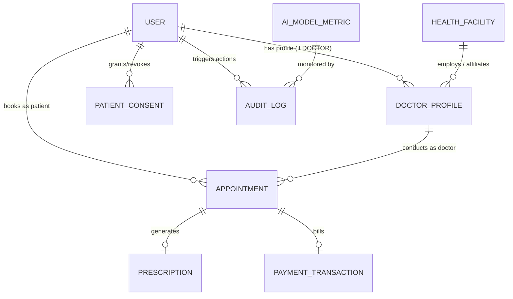

# HealthMate AI - Master Database & Cache Schema Specification
**Document Version:** 1.0.0  
**Phase:** Phase 0 - Master Architecture, Requirements Analysis & Development Planning  
**Primary Database:** MongoDB Atlas (Persistent Storage & Transactional Ledgers)  
**Ephemeral / Cache Store:** Redis (In-Memory Temporary Storage with Configurable TTL)  

---

## 1. Data Layer Architecture Overview

The HealthMate AI data tier is bifurcated into two strictly segregated layers:
1. **Ephemeral Layer (Redis):** Stores active guest sessions, raw symptom evaluations, intermediate OCR text, temporary health metric inputs, and AI chat memory. Evicted automatically via TTL or on-demand user purge.
2. **Persistent Layer (MongoDB Atlas):** Stores authenticated user identities, cryptographically hashed credentials, verified doctor registries, facility listings, confirmed appointment transactions, legal consent artifacts, and immutable security audit logs.



---

## 2. Redis Ephemeral Key Topology & TTL Policies

All keys use standardized prefixes and strict Time-To-Live expiration settings:

| Redis Key Pattern | Data Structure | Default TTL | Description & Purpose |
| :--- | :--- | :--- | :--- |
| `session:guest:<sessionId>` | Hash / JSON String | 3600 sec (1 hour) | Temporary guest triage context, vitals, and conversation messages. |
| `session:ocr:<uploadToken>` | JSON String | 1800 sec (30 min) | Extracted text and key-value lab biomarkers from uploaded reports. |
| `cache:geo:nearby:<lat_lng_hash>` | String (Compressed JSON) | 7200 sec (2 hours) | Cached Google Places / ABDM facility query results. |
| `ratelimit:api:<ip>:<route>` | Integer (Increment) | 60 sec (1 min) | Sliding window rate limiting counter for DDoS prevention. |
| `webrtc:room:<appointmentId>` | Set | 7200 sec (2 hours) | Active WebRTC peer connection session tokens and ICE candidate sync. |
| `otp:auth:<phone_or_email>` | String | 300 sec (5 min) | Cryptographically secure 6-digit OTP for login / verification. |

### Immediate Purge Command Pattern
When a user clicks "Delete Session / Forget Me":
```redis
DEL session:guest:<sessionId>
DEL session:ocr:<sessionId>
```

---

## 3. MongoDB Collection Specifications (Mongoose Schema Design)

### 3.1 Collection: `users`
Enforces the strict tri-role structure (`PATIENT`, `DOCTOR`, `ADMINISTRATION`).

```javascript
const UserSchema = new mongoose.Schema({
  email: {
    type: String,
    required: true,
    unique: true,
    lowercase: true,
    trim: true,
    index: true
  },
  phone: {
    type: String,
    required: false,
    trim: true,
    index: true
  },
  passwordHash: {
    type: String,
    required: true // Bcrypt / Argon2 hash
  },
  role: {
    type: String,
    enum: ['PATIENT', 'DOCTOR', 'ADMINISTRATION'],
    required: true,
    index: true
  },
  isVerified: {
    type: Boolean,
    default: false
  },
  status: {
    type: String,
    enum: ['ACTIVE', 'SUSPENDED', 'PENDING_APPROVAL'],
    default: 'ACTIVE'
  },
  refreshTokenHash: {
    type: String,
    default: null
  },
  lastLoginAt: {
    type: Date,
    default: null
  }
}, {
  timestamps: true,
  collection: 'users'
});
```

---

### 3.2 Collection: `doctor_profiles`
Maintains verified clinical credentials, registration numbers, specialization, and availability.

```javascript
const DoctorProfileSchema = new mongoose.Schema({
  userId: {
    type: mongoose.Schema.Types.ObjectId,
    ref: 'User',
    required: true,
    unique: true,
    index: true
  },
  fullName: {
    type: String,
    required: true,
    trim: true
  },
  medicalRegistrationNumber: {
    type: String,
    required: true,
    unique: true,
    trim: true,
    index: true // E.g., State Medical Council / NMC registration code
  },
  stateMedicalCouncil: {
    type: String,
    required: true // E.g., "Delhi Medical Council", "Maharashtra Medical Council"
  },
  qualifications: [{
    degree: { type: String, required: true }, // E.g., MBBS, MD, MS
    institution: { type: String, required: true },
    passingYear: { type: Number, required: true }
  }],
  specialization: {
    type: String,
    required: true,
    index: true // E.g., "Cardiology", "Dermatology", "Pediatrics", "General Medicine"
  },
  experienceYears: {
    type: Number,
    required: true,
    min: 0
  },
  verificationDocuments: [{
    docType: { type: String, enum: ['DEGREE', 'REGISTRATION_CERTIFICATE', 'GOVT_ID'] },
    fileUrl: { type: String, required: true },
    uploadedAt: { type: Date, default: Date.now }
  }],
  verificationStatus: {
    type: String,
    enum: ['DISCOVERED', 'SOURCE_VERIFIED', 'CREDENTIAL_VERIFIED', 'APPOINTMENT_ENABLED'],
    default: 'DISCOVERED',
    index: true
  },
  verifiedByAdminId: {
    type: mongoose.Schema.Types.ObjectId,
    ref: 'User',
    default: null
  },
  consultationFee: {
    type: Number,
    required: true,
    default: 500, // INR
    min: 0
  },
  availabilitySlots: [{
    dayOfWeek: { type: Number, min: 0, max: 6 }, // 0 = Sunday
    startTime: { type: String, required: true }, // "09:00"
    endTime: { type: String, required: true }, // "17:00"
    slotDurationMinutes: { type: Number, default: 20 }
  }],
  hospitalAffiliation: {
    facilityId: { type: mongoose.Schema.Types.ObjectId, ref: 'HealthFacility', default: null },
    facilityName: { type: String, default: 'Independent Clinic' }
  },
  location: {
    type: {
      type: String,
      enum: ['Point'],
      default: 'Point'
    },
    coordinates: {
      type: [Number], // [longitude, latitude]
      required: true,
      index: '2dsphere'
    }
  },
  address: {
    street: String,
    city: { type: String, required: true, index: true },
    state: { type: String, required: true, index: true },
    pincode: { type: String, required: true, index: true }
  },
  rating: {
    average: { type: Number, default: 0, min: 0, max: 5 },
    totalReviews: { type: Number, default: 0 }
  }
}, {
  timestamps: true,
  collection: 'doctor_profiles'
});
```

---

### 3.3 Collection: `health_facilities`
Stores clinics, hospitals, and pharmacies ingested via Google Places API and ABDM registries.

```javascript
const HealthFacilitySchema = new mongoose.Schema({
  sourceIdentifier: {
    type: String,
    unique: true,
    index: true // E.g., "gplaces_ChIJ...", "abdm_HFR_IN_..."
  },
  sourceType: {
    type: String,
    enum: ['GOOGLE_PLACES', 'ABDM_HFR', 'OFFICIAL_REGISTRY', 'PARTNER_API'],
    required: true,
    index: true
  },
  name: {
    type: String,
    required: true,
    index: true
  },
  facilityType: {
    type: String,
    enum: ['HOSPITAL', 'CLINIC', 'DIAGNOSTIC_LAB', 'PHARMACY'],
    required: true,
    index: true
  },
  statusTier: {
    type: String,
    enum: ['DISCOVERED', 'SOURCE_VERIFIED', 'CREDENTIAL_VERIFIED', 'APPOINTMENT_ENABLED'],
    default: 'DISCOVERED',
    index: true
  },
  departments: [String],
  contact: {
    phone: String,
    website: String,
    emergencyHotline: String
  },
  address: {
    formattedAddress: String,
    city: { type: String, index: true },
    state: { type: String, index: true },
    pincode: { type: String, index: true }
  },
  location: {
    type: {
      type: String,
      enum: ['Point'],
      default: 'Point'
    },
    coordinates: {
      type: [Number], // [longitude, latitude]
      required: true,
      index: '2dsphere'
    }
  },
  lastSynchronizedAt: {
    type: Date,
    default: Date.now,
    index: true
  }
}, {
  timestamps: true,
  collection: 'health_facilities'
});
```

---

### 3.4 Collection: `appointments`
Maintains transactional records of teleconsultations and clinic visits.

```javascript
const AppointmentSchema = new mongoose.Schema({
  patientId: {
    type: mongoose.Schema.Types.ObjectId,
    ref: 'User',
    required: true,
    index: true
  },
  doctorId: {
    type: mongoose.Schema.Types.ObjectId,
    ref: 'DoctorProfile',
    required: true,
    index: true
  },
  facilityId: {
    type: mongoose.Schema.Types.ObjectId,
    ref: 'HealthFacility',
    default: null
  },
  scheduledAt: {
    type: Date,
    required: true,
    index: true
  },
  durationMinutes: {
    type: Number,
    default: 20
  },
  consultationType: {
    type: String,
    enum: ['VIDEO', 'AUDIO', 'IN_PERSON'],
    default: 'VIDEO'
  },
  status: {
    type: String,
    enum: ['REQUESTED', 'CONFIRMED', 'CANCELLED', 'RESCHEDULED', 'COMPLETED', 'NO_SHOW'],
    default: 'REQUESTED',
    index: true
  },
  cancellationReason: {
    type: String,
    default: null
  },
  paymentStatus: {
    type: String,
    enum: ['PENDING', 'PAID', 'REFUNDED', 'FAILED'],
    default: 'PENDING',
    index: true
  },
  paymentReferenceId: {
    type: String,
    default: null
  },
  symptomSummarySnapshot: {
    // Retained ONLY with explicit transactional consent
    chiefComplaint: String,
    reportedDuration: String,
    triageCategory: String
  },
  teleconsultationRoomId: {
    type: String,
    default: null // Unique WebRTC UUID
  }
}, {
  timestamps: true,
  collection: 'appointments'
});
```

---

### 3.5 Collection: `prescriptions`
Digitally signed prescriptions generated by certified doctors.

```javascript
const PrescriptionSchema = new mongoose.Schema({
  appointmentId: {
    type: mongoose.Schema.Types.ObjectId,
    ref: 'Appointment',
    required: true,
    unique: true,
    index: true
  },
  doctorId: {
    type: mongoose.Schema.Types.ObjectId,
    ref: 'DoctorProfile',
    required: true,
    index: true
  },
  patientId: {
    type: mongoose.Schema.Types.ObjectId,
    ref: 'User',
    required: true,
    index: true
  },
  diagnosis: [{
    code: String, // ICD-10 code if applicable
    description: { type: String, required: true }
  }],
  medications: [{
    medicineName: { type: String, required: true },
    dosage: { type: String, required: true }, // E.g., "500mg"
    frequency: { type: String, required: true }, // E.g., "Twice daily after meals"
    durationDays: { type: Number, required: true },
    instructions: String
  }],
  investigationsRecommended: [String], // E.g., "Complete Blood Count (CBC)"
  dietaryAndLifestyleAdvice: String,
  followUpDate: Date,
  digitalSignature: {
    doctorNmcNumber: String,
    signedTimestamp: Date,
    signatureHash: String // SHA-256 digital verification hash
  }
}, {
  timestamps: true,
  collection: 'prescriptions'
});
```

---

### 3.6 Collection: `patient_consents`
DPDP Act 2023 compliance tracking for every health record interaction.

```javascript
const PatientConsentSchema = new mongoose.Schema({
  patientId: {
    type: mongoose.Schema.Types.ObjectId,
    ref: 'User',
    required: true,
    index: true
  },
  consentType: {
    type: String,
    enum: ['TEMPORARY_AI_ANALYSIS', 'PERSISTENT_HEALTH_VAULT', 'DOCTOR_CLINICAL_SHARE', 'TELEMEDICINE_RECORDING'],
    required: true
  },
  status: {
    type: String,
    enum: ['GRANTED', 'REVOKED'],
    default: 'GRANTED'
  },
  purposeDescription: {
    type: String,
    required: true
  },
  ipAddress: {
    type: String,
    required: true
  },
  userAgent: String,
  grantedAt: {
    type: Date,
    default: Date.now
  },
  revokedAt: {
    type: Date,
    default: null
  }
}, {
  timestamps: true,
  collection: 'patient_consents'
});
```

---

### 3.7 Collection: `audit_logs`
Immutable compliance and access logging for regulatory auditing.

```javascript
const AuditLogSchema = new mongoose.Schema({
  actorId: {
    type: mongoose.Schema.Types.ObjectId,
    ref: 'User',
    default: null // Null if anonymous guest
  },
  actorRole: {
    type: String,
    enum: ['GUEST', 'PATIENT', 'DOCTOR', 'ADMINISTRATION', 'SYSTEM_CRON'],
    required: true,
    index: true
  },
  action: {
    type: String,
    required: true,
    index: true // E.g., "PURGE_SESSION", "VIEW_PATIENT_RECORD", "APPROVE_DOCTOR", "DISCOVERY_SYNC"
  },
  targetResource: {
    resourceType: String,
    resourceId: String
  },
  ipAddress: String,
  statusCode: Number,
  metadata: mongoose.Schema.Types.Mixed
}, {
  timestamps: { createdAt: true, updatedAt: false }, // Immutable
  collection: 'audit_logs'
});
```

---

### 3.8 Collection: `ai_model_metrics`
MLOps monitoring collection tracking model performance, latency, and drift.

```javascript
const AIModelMetricSchema = new mongoose.Schema({
  modelName: {
    type: String,
    required: true,
    index: true // E.g., "triage_xgboost_v1.2", "report_paddleocr_v2"
  },
  modelVersion: {
    type: String,
    required: true
  },
  evaluationDate: {
    type: Date,
    default: Date.now
  },
  metrics: {
    accuracy: Number,
    f1Score: Number,
    rocAuc: Number,
    latencyMsP95: Number
  },
  driftDetected: {
    type: Boolean,
    default: false
  },
  status: {
    type: String,
    enum: ['ACTIVE', 'SHADOW', 'DEPRECATED'],
    default: 'ACTIVE'
  }
}, {
  timestamps: true,
  collection: 'ai_model_metrics'
});
```
