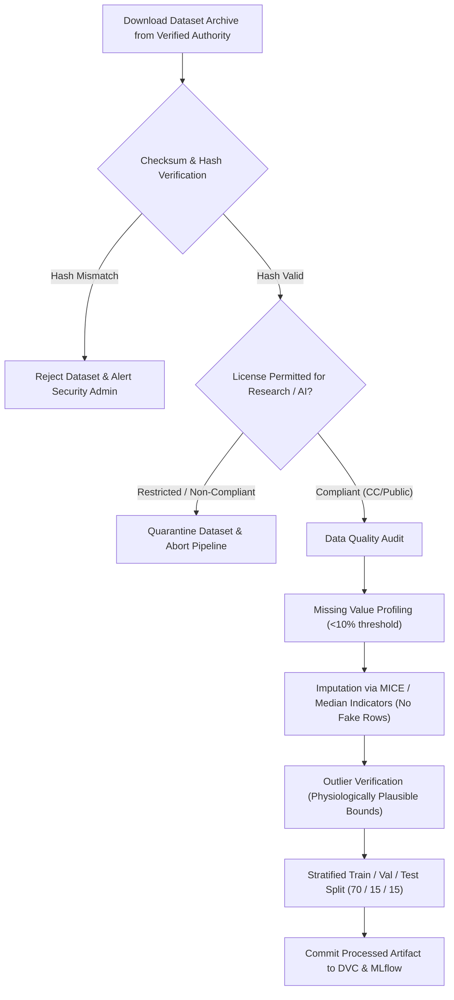

# HealthMate AI - Master Machine Learning Dataset Catalog
**Document Version:** 1.0.0  
**Phase:** Phase 0 - Master Architecture, Requirements Analysis & Development Planning  
**Policy Compliance:** Open Research Data Licensing, Verification Gates, Zero Synthetic Fabrication  

---

## 1. Catalog Scope & Governance

This catalog specifies the authentic clinical and biomedical research datasets utilized for training, cross-validating, and benchmarking HealthMate AI's predictive models.

In strict accordance with development instructions:
- **No synthetic or randomly generated patient records** are admitted into training pipelines.
- Every dataset is verified for source validity, open research licensing, feature integrity, class balance, and clinical relevance before automated ingestion.

---

## 2. Verified Research Datasets Catalog

| Dataset ID | Dataset Name & Official Source | License Type | Clinical Domain & Target Prediction | Sample Size & Features | Verification & Ingestion Mechanism |
| :--- | :--- | :--- | :--- | :--- | :--- |
| **DS-CARDIO-01** | **Cardiovascular Disease Dataset** (PhysioNet / Mendeley Data) | CC BY 4.0 Open Access | Heart disease presence binary classification & risk tier | 70,000 records; 11 clinical features (Age, Gender, Systolic BP, Diastolic BP, Cholesterol, Glucose, Smoker, Alcohol, Physical Activity, BMI, Target) | Ingested via PhysioNet REST API with SHA-256 checksum verification. |
| **DS-DIAB-02** | **Diabetes Health Indicators Dataset** (CDC Behavioral Risk Factor Surveillance System) | Public Domain / US CDC | Diabetes risk assessment (Non-diabetic, Pre-diabetic, Diabetic) | 253,680 records; 21 survey & clinical features (HighBP, HighChol, BMI, Smoker, Stroke, HeartDiseaseorAttack, PhysActivity, etc.) | Automated download via CDC Open Data Portal (Data.gov). |
| **DS-SYMPT-03** | **Disease Symptom & Severity Knowledgebase** (Columbia University Medical Center / Kaggle Research) | ODbL / CC BY-SA 4.0 | Symptom-to-condition association and differential triage | 4,920 disease-symptom mapping pairs; 132 symptom indicator columns, 41 prognostic classes | Automated pipeline ingestion; normalized into one-hot symptom matrix. |
| **DS-CHEST-04** | **NIH ChestX-ray8 / 14 Clinical Center** (National Institutes of Health Clinical Center) | CC0 Public Domain / Open Research | Thoracic pathology detection & anomaly flagging | 112,120 frontal-view X-ray images from 30,805 unique patients; 14 thoracic disease labels | S3 open research bucket with NIH validation protocol. |
| **DS-LAB-05** | **Clinical Diagnostic Lab Report Benchmark** (Zenodo Open Healthcare Corpus) | CC BY 4.0 Open Access | OCR text & key-value biomarker extraction evaluation | 1,500 annotated multi-layout pathology & biochemistry report images | Automated ingestion with bounding-box ground truth JSON. |
| **DS-DDI-06** | **DrugBank Open / Twosides Drug Interaction Dataset** (Stanford University / NLM) | Academic Research License | Adverse drug-drug interaction warning generation | 63,473 drug pairs; 1,318 adverse event interaction classes | Automated graph builder connecting RxNorm active pharmaceutical ingredients. |

---

## 3. Dataset Verification, Preprocessing & Quality Assurance Protocol

### Physiological Outlier & Bounds Enforcement
During preprocessing, biometric inputs are strictly verified against medically established human physiological limits:
- **Systolic Blood Pressure:** 50 mmHg to 300 mmHg
- **Diastolic Blood Pressure:** 30 mmHg to 200 mmHg
- **Heart Rate:** 30 bpm to 260 bpm
- **SpO2 (Oxygen Saturation):** 50% to 100%
- **Body Temperature:** 30.0°C to 45.0°C (86.0°F to 113.0°F)
- **Blood Glucose:** 20 mg/dL to 800 mg/dL

Any training records falling outside these bounds are flagged as sensor or entry errors and eliminated rather than imputed with fabricated values.
