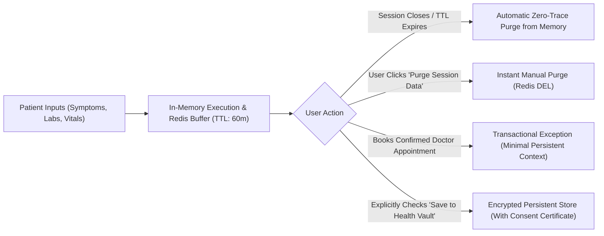

# HealthMate AI - Master Patient Data Privacy & Consent Policy
**Document Version:** 1.0.0  
**Phase:** Phase 0 - Master Architecture, Requirements Analysis & Development Planning  
**Legal Framework:** Digital Personal Data Protection Act (DPDP Act 2023 - India), Information Technology Act 2000, NMC Telemedicine Guidelines  

---

## 1. Core Principle: Zero-Trust Ephemeral Storage by Default

HealthMate AI is engineered from the ground up to guarantee that **patient health data is temporary by default**. 

No user symptom description, conversational dialogue with the AI Copilot, vitals reading, or uploaded medical report is ever committed to persistent disk storage (MongoDB Atlas or cold cloud storage) without deliberate, affirmative, and recorded consent.

---

## 2. Ephemeral vs. Persistent Classification

| Data Category | Storage Mechanism | Retention Policy | Erasure Protocol | Legal Basis |
| :--- | :--- | :--- | :--- | :--- |
| **Symptom Descriptions & Vitals** | Redis In-Memory Hash | Maximum 60 minutes TTL | Automatic Redis TTL key eviction or instant user deletion | Ephemeral user consultation; no persistent record retained |
| **AI Copilot Chat History** | Redis Session Buffer | Session lifetime (Max 60 min) | Purged on tab close, session reset, or TTL expiry | Ephemeral conversational context |
| **Uploaded Medical Reports (PDF/Images)** | Secure Temporary Bucket (presigned URL) | Maximum 30 minutes | AWS S3 Lifecycle Expiration Rule + in-memory RAM wipe | Ephemeral OCR biomarker extraction |
| **Extracted OCR Lab Biomarkers** | In-Memory FastAPI response | Returned directly in HTTP response payload | Never saved to persistent database | Ephemeral diagnostic feedback |
| **Confirmed Appointments & Invoices** | MongoDB `appointments` & `payment_transactions` | 7 years (Statutory financial & telemedicine audit requirement) | Encrypted archive; accessible only to patient, treating doctor, and tax auditor | Statutory transactional compliance (DPDP Act §8 / Income Tax Act) |
| **Signed Digital Prescriptions** | MongoDB `prescriptions` | 3 years (NMC Telemedicine Guidelines 2020) | Patient retains right to download; legally binding medical order | NMC Telemedicine Practice Guidelines |
| **DPDP Consent Audit Records** | MongoDB `patient_consents` | 7 years | Immutable audit trail proving when consent was granted, modified, or revoked | Section 6, DPDP Act 2023 |

---

## 3. Transactional Exception Disclosure

When a patient transitions from an anonymous guest triage session to a confirmed doctor consultation:
1. **Notice Displayed:** The patient is presented with an unambiguous disclosure:
   > *"To schedule your appointment with Dr. [Name], we will securely retain your appointment time, contact phone number, payment transaction reference, and a summary of your chief complaint. This information is legally required to coordinate clinical care and ensure your medical prescription is valid under NMC guidelines."*
2. **Minimal Necessary Retention:** The platform retains *only* the chief complaint and vital signs summary relevant to the booked specialty. Unrelated conversation history and raw uploaded images are deleted.
3. **No Cross-Profile Correlation:** HealthMate AI does not sell, broker, or aggregate clinical consultation data with external advertising networks or data aggregators.

---

## 4. Patient Rights Under DPDP Act 2023

1. **Right to Access & Summary (§11):** Any authenticated patient can download a complete, machine-readable JSON archive of all persistent records associated with their identifier via `GET /patient/data-export`.
2. **Right to Correction & Erasure (§12):** A patient may update inaccurate profile details or request the cryptographic tombstoning of their account via `DELETE /patient/account`.
3. **Right of Grievance Redressal (§13):** The platform provides an in-app Data Protection Officer (DPO) ticketing system with an SLA of 72 hours for grievance resolution.
4. **Instant Session Purge ("Forget Me"):** Available as a persistent, high-visibility button in the patient interface, allowing instant eviction of all active Redis session keys.
