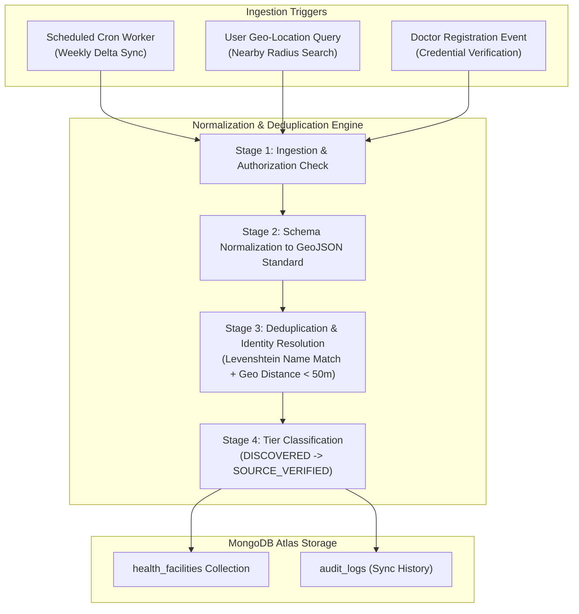

# HealthMate AI - Master External Data Source Registry
**Document Version:** 1.0.0  
**Phase:** Phase 0 - Master Architecture, Requirements Analysis & Development Planning  
**Compliance Context:** Ayushman Bharat Digital Mission (ABDM), National Digital Health Blueprint, Google API Terms of Service, National Medical Commission (NMC) Guidelines  

---

## 1. Scope & Objective

This registry catalogs all official, legal, and authentic data sources integrated into HealthMate AI for:
1. Automated discovery of hospitals, clinics, diagnostic centers, and pharmacies across India.
2. Verification of medical practitioner credentials (NMC and State Medical Councils).
3. Retrieval of clinical knowledge, medical treatment guidelines, and drug interaction datasets.

Under strict development rules, **no records may be fabricated or manually forged into database tables**. All entities originate from verified external sources subject to permission validation and licensing checks.

---

## 2. External Data Source Master Catalog

| Source Identifier | Source Name & Issuing Authority | Data Domain | Access Protocol & Endpoints | Licensing & Permitted Use | Ingestion Frequency | Status & Availability Assessment |
| :--- | :--- | :--- | :--- | :--- | :--- | :--- |
| **SRC-GPLACES-01** | Google Places API (New) (Google Cloud Platform) | Hospitals, Clinics, Pharmacies, Diagnostic Centers | REST / JSON via `places.googleapis.com/v1/places:searchNearby` | Commercial API Key required. Paid per request. Complies with Google Places TOS. | On-Demand (Cached in Redis for 2 hours) | **Accessible & Active** (Requires GCP billing account & API key). |
| **SRC-ABDM-HFR-02** | Health Facility Registry (HFR) (National Health Authority - ABDM) | Public & Private Accredited Hospitals, Community Health Centers | ABDM Sandbox Gateway (`sandbox.abdm.gov.in/hfr/api/v1`) | Open Government Data License / ABDM Sandbox Partner Agreement. Requires Client ID & Client Secret. | Weekly batch delta sync | **Sandbox Accessible** (Requires developer sandbox enrollment). |
| **SRC-ABDM-HPR-03** | Healthcare Professionals Registry (HPR) (NHA / ABDM) | Certified Doctors, Specialists, Registered Medical Practitioners | ABDM Gateway (`sandbox.abdm.gov.in/hpr/api/v1`) | Restricted to verified healthcare entities under ABDM NDHM framework. | Verification on-demand per doctor onboarding | **Restricted / Sandbox Only** (Official partnership required for production write-access). |
| **SRC-NMC-DOC-04** | National Medical Commission (NMC) Indian Medical Register | State Medical Council Registration Numbers, Qualifications | Public Search Portal (`nmc.org.in/information-desk/indian-medical-register`) | Public Medical Register for patient verification. Automated queries subject to rate limits. | Admin verification trigger | **Public Web / Scraping Limited** (Captcha-gated; requires manual admin review or approved API partner). |
| **SRC-PUBMED-05** | National Library of Medicine (NLM / NCBI PubMed) | Biomedical Literature & Clinical Guidelines for RAG | E-utilities REST API (`eutils.ncbi.nlm.nih.gov/entrez/eutils`) | Open Access / Public Domain (with NCBI API Key for 10 req/s rate limit). | Bi-weekly corpus ingestion for FAISS index | **Accessible & Active** (Free API Key available). |
| **SRC-RXNORM-06** | National Library of Medicine RxNorm / NDF-RT | Drug-Drug Interactions, Generic Formulations, Brand Names | REST API (`rxnav.nlm.nih.gov/REST`) | Public Domain US NLM (Openly accessible without authentication). | Monthly update sync | **Accessible & Active** (No auth required). |

---

## 3. Data Processing & Synchronization Pipeline

---

## 4. Inaccessible or Restricted Data Sources & Fallback Protocols

1. **National Medical Commission (NMC) Direct API:**
   - *Constraint:* The official NMC website currently provides a public web lookup interface rather than an open, tokenized JSON API for third-party automated queries. Certain lookup queries may present anti-bot mechanisms.
   - *Architectural Fallback:* Implement a structured Doctor Credential Verification Queue in the Administration Portal where doctors upload their State Medical Council registration certificate and NMC registration number. The system performs automated OCR and regex validation of the registration format, pre-fills the verification form, and routes it to an Administrator for final approval against the state registry.
2. **ABDM Production Environment:**
   - *Constraint:* Direct integration into the ABDM Production ecosystem requires government-level hardware security modules (HSM) and formal administrative security clearance.
   - *Architectural Fallback:* Utilize the official **ABDM Sandbox Environment**, which provides identical API contracts (M1, M2, M3 milestones) for Health Facility Registry (HFR) and Healthcare Professional Registry (HPR) simulation.
