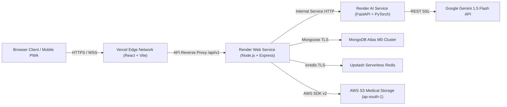

# HEALTHMATE AI — CLOUD DEPLOYMENT & INFRASTRUCTURE TOPOLOGY

**Project Name:** HEALTHMATE AI  
**Academic Degree:** B.Tech Computer Science & Engineering (AI/ML)  
**Document Code:** ENG-DOC-14  
**Live Target URLs:**
- **Frontend Web:** [https://healthmate-ai-nine-mocha.vercel.app](https://healthmate-ai-nine-mocha.vercel.app)
- **Backend API:** [https://healthmate-backend-9nmm.onrender.com](https://healthmate-backend-9nmm.onrender.com)
- **AI Microservice:** [https://healthmate-ai-service.onrender.com](https://healthmate-ai-service.onrender.com)

---

## 1. MULTI-CLOUD ARCHITECTURAL TOPOLOGY



---

## 2. DEPLOYMENT CONFIGURATIONS

### 2.1 Frontend: Vercel Edge (`frontend/vercel.json`)
```json
{
  "rewrites": [
    {
      "source": "/api/v1/(.*)",
      "destination": "https://healthmate-backend-9nmm.onrender.com/api/v1/$1"
    },
    {
      "source": "/(.*)",
      "destination": "/index.html"
    }
  ],
  "headers": [
    {
      "source": "/(.*)",
      "headers": [
        { "key": "X-Content-Type-Options", "value": "nosniff" },
        { "key": "X-Frame-Options", "value": "DENY" },
        { "key": "X-XSS-Protection", "value": "1; mode=block" }
      ]
    }
  ]
}
```

### 2.2 Backend: Render Web Service (`render.yaml` or Dashboard)
- **Runtime:** Node.js 20.x LTS
- **Build Command:** `npm install --omit=dev`
- **Start Command:** `node src/server.js`
- **Health Check Path:** `/health`
- **Auto-Deploy:** Enabled on GitHub `main` branch push.

### 2.3 AI Microservice: Render Python Web Service
- **Runtime:** Python 3.11.11
- **Build Command:** `pip install --no-cache-dir -r requirements.txt`
- **Start Command:** `uvicorn app.main:app --host 0.0.0.0 --port $PORT`
- **Health Check Path:** `/health`

---

## 3. ZERO-DOWNTIME CI/CD & ROLLBACK

All updates pushed to `origin main` trigger automated build verification on Vercel and Render. In case of health-check failure, Render instantly halts routing and preserves the previous stable deployment container.
