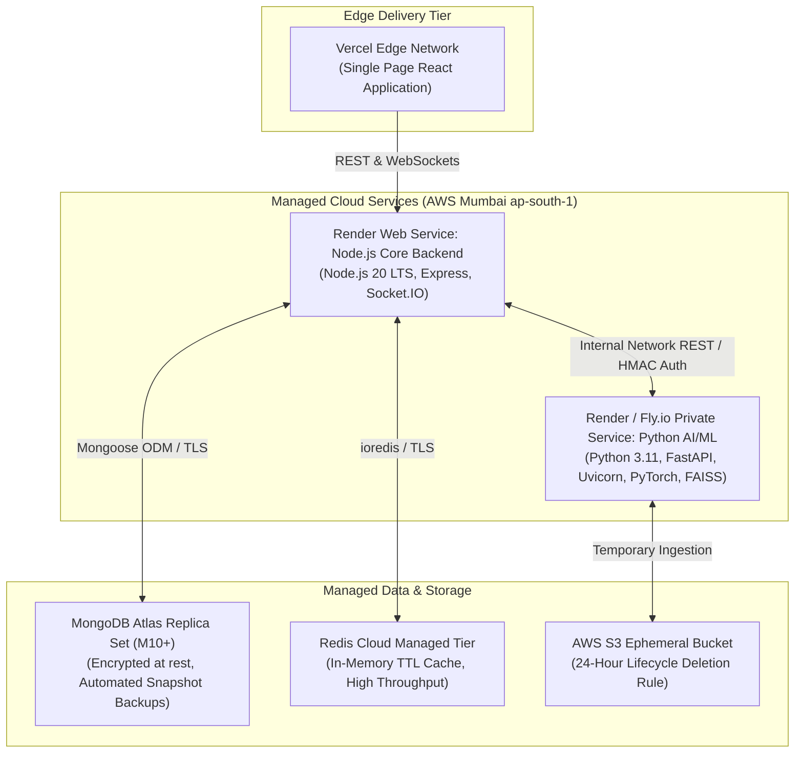

# HealthMate AI - Master Production Deployment & Infrastructure Guide
**Document Version:** 1.0.0  
**Phase:** Phase 0 - Master Architecture, Requirements Analysis & Development Planning  
**Target Environments:** Vercel (Frontend), Render / Fly.io (Backend & AI Microservice), MongoDB Atlas (DB), Redis Cloud (Cache)  

---

## 1. Production Architecture Topography



---

## 2. Service-by-Service Deployment Configuration

### 2.1 Frontend Single Page Application (Vercel)
- **Framework Preset:** Vite
- **Build Command:** `npm run build`
- **Output Directory:** `dist`
- **Environment Variables:**
  - `VITE_API_BASE_URL`: `https://api.healthmate.ai/api/v1`
  - `VITE_SOCKET_URL`: `https://api.healthmate.ai`
  - `VITE_RAZORPAY_KEY_ID`: `rzp_live_...`
- **Routing Configuration (`vercel.json`):**
  ```json
  {
    "rewrites": [
      { "source": "/(.*)", "destination": "/index.html" }
    ],
    "headers": [
      {
        "source": "/(.*)",
        "headers": [
          { "key": "X-Frame-Options", "value": "DENY" },
          { "key": "X-Content-Type-Options", "value": "nosniff" },
          { "key": "Referrer-Policy", "value": "strict-origin-when-cross-origin" }
        ]
      }
    ]
  }
  ```

---

### 2.2 Node.js Core Backend (Render Web Service)
- **Environment:** Node 20 LTS
- **Build Command:** `npm install`
- **Start Command:** `npm run start` (Runs `node server.js` with clustering or PM2)
- **Health Check Path:** `GET /health` (Verifies DB connection, Redis ping, and memory pressure)
- **Auto-Deploy:** Enabled on push to `main` branch after CI tests pass.

---

### 2.3 Python AI/ML Microservice (Dockerized Container on Render / Fly.io)
- **Container Base:** `python:3.11-slim` with system packages `libgomp1`, `ffmpeg`, `libgl1` (for PaddleOCR and PyTorch).
- **Dockerfile Specification:**
  ```dockerfile
  FROM python:3.11-slim

  ENV PYTHONDONTWRITEBYTECODE=1 \
      PYTHONUNBUFFERED=1

  WORKDIR /app

  RUN apt-get update && apt-get install -y --no-install-recommends \
      build-essential \
      libgomp1 \
      libgl1 \
      libglib2.0-0 \
      && rm -rf /var/lib/apt/lists/*

  COPY requirements.txt .
  RUN pip install --no-cache-dir -r requirements.txt

  COPY . .

  EXPOSE 8000

  CMD ["uvicorn", "main:app", "--host", "0.0.0.0", "--port", "8000", "--workers", "2"]
  ```
- **Health Check Path:** `GET /health` (Verifies model weights loaded in memory and FAISS vector index status).

---

## 3. Database & Cache Initialization

1. **MongoDB Atlas:**
   - Deploy Cluster in AWS Region `ap-south-1` (Mumbai) to ensure low latency (<20ms).
   - Configure IP Access List: Whitelist Render static outbound IPs or use VPC peering.
   - Run index creation scripts (`db.doctor_profiles.createIndex({ location: "2dsphere" })`).
2. **Redis Cloud:**
   - Deploy Redis 7.x instance in `ap-south-1`.
   - Set maxmemory policy: `volatile-ttl` (Automatically evicts keys with an expire set when memory limit is reached).

---

## 4. Continuous Integration & Deployment (GitHub Actions)

```yaml
name: HealthMate AI CI/CD Pipeline

on:
  push:
    branches: [ main ]
  pull_request:
    branches: [ main ]

jobs:
  test-node-backend:
    runs-on: ubuntu-latest
    steps:
      - uses: actions/checkout@v4
      - uses: actions/setup-node@v4
        with:
          node-version: 20
      - run: cd backend && npm ci
      - run: cd backend && npm test

  test-python-ai:
    runs-on: ubuntu-latest
    steps:
      - uses: actions/checkout@v4
      - uses: actions/setup-python@v5
        with:
          python-version: 3.11
      - run: cd ai-service && pip install -r requirements.txt
      - run: cd ai-service && pytest tests/
```
