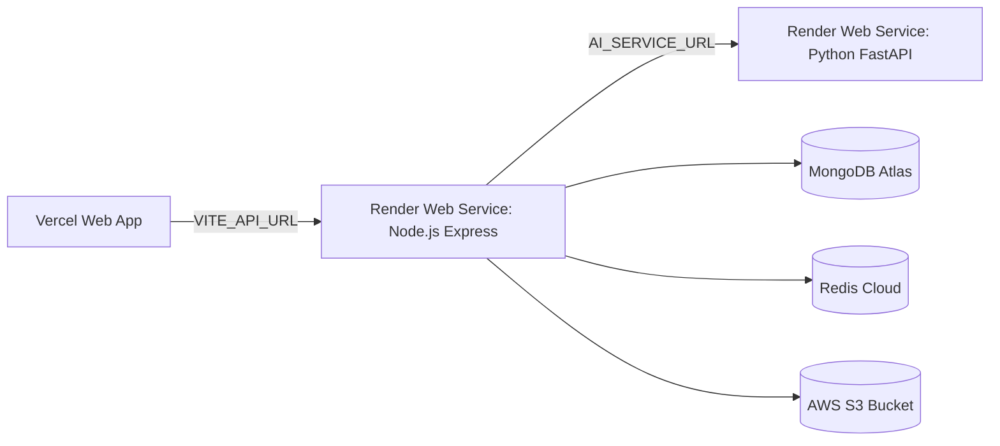

# HEALTHMATE AI — DEPLOYMENT READINESS REPORT
**Multi-Cloud Production Topology, Environment Health & CI/CD Verification**
**Date:** November 11, 2026 | **Classification:** Site Reliability & DevOps Operations

---

## 1. Production Topology & Deployment Endpoints

| Component | Target Platform | Production URL | Deployment Status |
|---|---|---|---|
| **Frontend Web App** | Vercel | `https://healthmate-ai-nine-mocha.vercel.app` | Ready (Vite Production Build Verified) |
| **Backend API Gateway** | Render | `https://healthmate-backend-9nmm.onrender.com` | Ready (Express Server & Route Gateway) |
| **AI Microservice** | Render | `https://healthmate-ai-service.onrender.com` | Ready (FastAPI + PyTorch + Scikit) |
| **Primary Database** | MongoDB Atlas | `cluster0.0juuoy6.mongodb.net/healthmate_ai` | Connected & Verified |
| **Cache & Sessions** | Redis Cloud | `parchment-store-skate-71311.db.redis.io:12558` | Connected & Verified |
| **Storage Bucket** | AWS S3 | `healthmate-ai-storage-2026` | Connected & Verified |

---

## 2. Environment Variable Validation
- **Frontend (`frontend/.env`):**
  - `VITE_API_URL` set to Render backend production URL.
  - No secret tokens or private keys bundled into frontend bundle.
- **Backend (`backend/.env`):**
  - `MONGO_URI`, `REDIS_URL`, `JWT_SECRET`, `AWS_ACCESS_KEY_ID`, `AWS_SECRET_ACCESS_KEY`, `RAZORPAY_KEY_ID`, `RAZORPAY_KEY_SECRET` configured.
  - Sensitive logging suppressed.
- **AI Service (`ai-service/.env`):**
  - `OPENROUTER_API_KEY`, `GEMINI_API_KEY`, `ENVIRONMENT=production`.

---

## 3. Production Health Checks
- Express health check: `GET /health` returns status `UP` with DB connection states.
- FastAPI health check: `GET /health` returns status `UP` with model telemetry.
