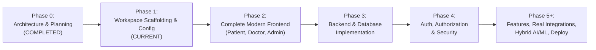

# HealthMate AI - Master Development Roadmap & Phase Sequence
**Document Version:** 1.0.0  
**Phase:** Phase 0 - Master Architecture, Requirements Analysis & Development Planning  
**Execution Governance:** Gated Phase Progression (Each phase requires verification before advancing)  

---

## 1. Roadmap Phase Progression Overview

---

## 2. Detailed Phase Specifications & Completion Gates

### Phase 0: Master Architecture, Requirements & Specifications (COMPLETED)
- **Objective:** Establish enterprise software architecture, database design, API contracts, MLOps blueprints, privacy mechanisms, and integration registries.
- **Deliverables:** 13 architecture markdown specifications in workspace root.
- **Exit Gate:** Formal user sign-off and approval achieved.

---

### Phase 1: Workspace Scaffolding, Base Infrastructure & Environment Config (CURRENT)
- **Objective:** Initialize monorepo directory structure, package manifests (`package.json`, `requirements.txt`), Docker Compose for local development, base servers with health checks, and unified environment config loaders.
- **Key Deliverables:**
  - `frontend/`: React 18, Vite, Tailwind CSS, Lucide icons, Framer Motion, Recharts base setup with base route scaffolding.
  - `backend/`: Node.js 20 LTS, Express, Mongoose, ioredis, Socket.IO plumbing, environment configuration with health check endpoint (`/health`).
  - `ai-service/`: Python 3.11, FastAPI, Uvicorn, Pydantic, LLM dispatcher (OpenRouter Primary + Gemini Fallback with retries/timeouts), health check (`/health`).
  - `docker-compose.yml`: Optional local development services (MongoDB, Redis, Node backend, Python AI service).
  - Unified `.env.example` with clear, non-hardcoded variable schemas.
- **Exit Gate:** All three services build cleanly, pass lint/dependency/health checks, and tests execute with green status.

---

### Phase 2: Complete Modern Frontend Development (Patient, Doctor, Administration)
- **Objective:** Build complete, high-performance, responsive, accessible Single Page Application interfaces for all three roles:
  - Patient Portal: Guest triage workflow, AI Health Copilot interface, multimodal symptom inputs, medical report OCR extraction viewer, India-wide & nearby doctor discovery, appointment booking, digital prescriptions, vitals tracking, and "Forget Me" instant purge modal.
  - Doctor Portal: Availability calendar manager, clinical consultation workspace, AI clinical copilot / SOAP note drafter, digital prescription builder with digital signing.
  - Administration Portal: Doctor credential verification queue, facility ingestion monitor, MLOps model registry & drift monitor, and DPDP compliance audit log viewer.
- **Exit Gate:** Zero console errors, responsive design across mobile/desktop, interactive states, and verified visual workflows.

---

### Phase 3: Backend and Database Implementation
- **Objective:** Implement full MongoDB Atlas data models, Redis ephemeral session store with TTL policies, discovery sync workers, appointment ledger, and core REST APIs.
- **Exit Gate:** Complete database CRUD operations and Redis TTL eviction mechanisms verified.

---

### Phase 4: Authentication, Authorization and Security
- **Objective:** Implement strict tri-role RBAC (`PATIENT`, `DOCTOR`, `ADMINISTRATION`), JWT with refresh token rotation, password hashing, OTP verification, rate limiting, and HMAC inter-service authentication.
- **Exit Gate:** 100% RBAC security tests passing with zero unauthorized role bypass.

---

### Phase 5 Onwards: Patient Features, Doctor Features, Administration, Real Integrations, Hybrid AI/ML, Testing & Deployment
- **Objective:** Implement Hybrid AI/ML microservice (XGBoost triage, SHAP, PaddleOCR, FAISS RAG, OpenRouter/Gemini LLM pipeline), real-world data discovery (Google Places, ABDM sandbox), WebRTC teleconsultations, Razorpay integration, DPDP privacy audits, and production deployment on Vercel, Render, and Fly.io.
- **Exit Gate:** Full end-to-end integration tests, load tests, and production verification.
