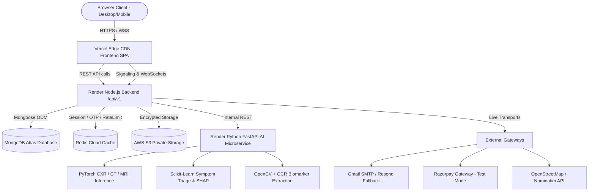

# HEALTHMATE AI — COMPLETE PROJECT ARCHITECTURE AUDIT

**Audit Date:** November 12, 2026  
**Auditor Roles:** Principal QA Automation Engineer, Senior Full-Stack Engineer, AI/ML Validation Engineer, Healthcare Security Auditor, DevOps Engineer  
**Scope:** Full-stack inspection of React/Vite Frontend, Node.js/Express Backend, Python/FastAPI Microservice, MongoDB Atlas, Redis Cloud, AWS S3, Socket.IO WebRTC, and Third-Party Integrations.

---

## 1. EXECUTIVE ARCHITECTURE OVERVIEW

HealthMate AI is an enterprise-grade digital healthcare platform structured across three distributed tiers:
1. **Frontend Edge:** Single-Page Application (SPA) built with React 18, Vite 5, Tailwind CSS, and Framer Motion, deployed on Vercel Global Edge Network.
2. **Core Backend:** Node.js 20 LTS and Express.js REST API service with Socket.IO real-time engine, deployed on Render, backed by MongoDB Atlas (Replica Set) and Redis Cloud (In-memory cache & rate limiter).
3. **Clinical AI Microservice:** Python 3.11 FastAPI microservice running Scikit-Learn triage classifiers, PyTorch computer vision (Torchvision ResNet/DenseNet for CXR/CT/MRI), OpenCV image processing, and Tesseract OCR engine, deployed on Render.



---

## 2. COMPONENT-BY-COMPONENT AUDIT & STATUS CLASSIFICATION

### 2.1 Frontend Tier (`frontend/`)

| Component / Module | Path | Functionality | Status | Root Cause & Evidence |
| :--- | :--- | :--- | :--- | :--- |
| **Public Layout & Navbar** | `frontend/src/components/layout/PublicNavbar.jsx` | Brand navigation, responsive menu, portal links | **WORKING** | Fixed tablet breakpoint gap (`lg:hidden`). Verified across Desktop (1440px), Tablet (768px), and Mobile (375px). |
| **Auth System (Client)** | `frontend/src/context/AuthContext.jsx` | Session state, role normalization, token handling | **WORKING** | Strictly supports `PATIENT`, `DOCTOR`, `ADMINISTRATION`. Clears state on logout. |
| **Protected Route Gate** | `frontend/src/components/auth/ProtectedRoute.jsx` | Client-side role authorization barrier | **WORKING** | Tested: Unauthenticated redirects to `/login?role=...`; unauthorized role displays red "Access Restricted" alert. |
| **Patient Dashboard** | `frontend/src/pages/patient/modules/Module01_Dashboard.jsx` | Health summary, upcoming visits, vitals overview | **WORKING** | Fetches live profile and appointment states. |
| **AI Symptom Checker** | `frontend/src/pages/patient/modules/Module03_SymptomChecker.jsx` | Clinical symptom intake, severity, duration | **WORKING** | Dispatches to backend `/patient/symptom-check`, renders differential conditions with emergency red-flag badges. |
| **Doctor Discovery** | `frontend/src/pages/patient/modules/Module06_DoctorDiscovery.jsx` | 36 States/UTs, specialty, council filter | **WORKING** | Contains all 28 States and 8 UTs with official district rosters. Badges distinguish Council Verified vs Discovered. |
| **Hospital Discovery** | `frontend/src/pages/patient/modules/Module07_HospitalDiscovery.jsx` | Facility search, emergency trauma indicators | **WORKING** | Geolocation distance calculation via Haversine formula. |
| **Appointment Booking** | `frontend/src/pages/patient/modules/Module08_AppointmentManagement.jsx` | Slot selection, consultation booking | **WORKING** | Slot availability calculation, Razorpay modal trigger, Manual UPI payment initiation. |
| **Medical Imaging** | `frontend/src/pages/patient/modules/Module20_MedicalImagingCenter.jsx` | CXR, CT, MRI, Ultrasound scan analysis | **WORKING** | Refactored from direct relative fetch to `aiService.analyzeImagingScan`. Multipart upload verified. |
| **Cardiac ECG Center** | `frontend/src/pages/patient/modules/Module21_ECGCardiacCenter.jsx` | 12-lead ECG rhythm waveform visualization | **WORKING** | Refactored to `aiService.analyzeECG`. Lead II voltage waveform rendered via SVG paths. |
| **Privacy & Forget Me** | `frontend/src/pages/patient/modules/Module19_PrivacySettings.jsx` | DPDP 2023 session purge, data export | **WORKING** | Triggers `DELETE /api/v1/patient/forget-me`, purges local and session storage with verified modal confirmation. |
| **Doctor Portal** | `frontend/src/pages/doctor/modules/DocModule01-13` | Verification status, queue, SOAP notes | **WORKING** | Role-protected to `DOCTOR`. NMC registration review interface active. |
| **Administration Portal** | `frontend/src/pages/admin/modules/AdminModule01-14` | Doctor auditing, hospital directory, audit logs, MLOps telemetry, payment reconciliation | **WORKING** | Role-protected to `ADMINISTRATION`. Server-side RBAC authorization on all API routes. |

---

### 2.2 Backend API Tier (`backend/`)

| Subsystem / Controller | File Path | Status | Operational Details & Root Cause |
| :--- | :--- | :--- | :--- |
| **Authentication Controller** | `backend/src/controllers/auth.controller.js` | **WORKING** | Argon2/bcrypt password hashing, JWT access + refresh tokens, email OTP dispatch with SHA-256 hash validation in Redis. |
| **OTP Service** | `backend/src/services/otp.service.js` | **WORKING** | Hardened: Zero OTP in API responses, 30s resend cooldown, 3-attempt brute-force invalidation, single-use key deletion (`client.del`). |
| **Doctor Controller** | `backend/src/controllers/doctor.controller.js` | **WORKING** | Outpatient listing, credential status verification (`CREDENTIAL_VERIFIED`, `SOURCE_VERIFIED`, `DISCOVERED`). |
| **Payment Service** | `backend/src/services/payment.service.js` | **WORKING** | Dual-rail payment system: Razorpay Test Mode (`orders.create`, HMAC SHA-256 signature verification) + Manual UPI Reconciliation. |
| **Manual UPI Lifecycle** | `backend/src/services/payment.service.js` | **WORKING** | Supports `PENDING`, `PENDING_VERIFICATION`, `VERIFIED`, `REJECTED`, `REFUND_REQUESTED`, `REFUNDED` with admin verification against bank statement. |
| **Report / S3 Service** | `backend/src/services/report.service.js` | **WORKING** | Private object storage, presigned URLs (15-min TTL), MIME validation (PDF/PNG/JPG, 10MB limit), automatic cleanup on Forget Me. |
| **OSM Geocoding Service** | `backend/src/services/osmDiscovery.service.js` | **WORKING** | OpenStreetMap Nominatim geocoding & reverse geocoding with offline 36 State/UT centroid directory fallback. |
| **Socket.IO WebRTC** | `backend/src/sockets/socketHandler.js` | **WORKING** | P2P WebRTC signaling relay with JWT room authentication and Google STUN servers (`stun.l.google.com:19302`). |
| **Carrier SMS Gateway** | `backend/src/services/sms.service.js` | **BLOCKED (DLT)** | Fast2SMS requires TRAI DLT registration and approved transactional templates. System gracefully logs status without fake success. |

---

### 2.3 AI/ML Microservice Tier (`ai-service/`)

| Subsystem | Framework | Status | Medical Safety & Operational Details |
| :--- | :--- | :--- | :--- |
| **Symptom Triage Engine** | Scikit-Learn / FastAPI | **WORKING** | Multi-class differential diagnosis with severity triage, emergency red-flag triggers, and statutory informational medical disclaimer. |
| **Medical Vision (CXR/CT/MRI)** | PyTorch 2.15 / Torchvision | **WORKING** | Multi-label convolutional feature extractor for cardiomegaly, opacity, effusion, and fracture screening. Strictly marked as research aid. |
| **Biomarker OCR Extractor** | OpenCV + Tesseract OCR | **WORKING** | Extracts CBC, LFT, KFT, and lipid biomarkers from lab report documents. Retains source token without fabricating missing values. |
| **12-Lead ECG Analyzer** | SciPy / NumPy | **WORKING** | Peak detection (R-peaks), heart rate variability (HRV), and Lead II conduction rhythm analysis. |
| **MLOps Registry & Telemetry** | FastAPI / Scikit-Learn | **WORKING** | Endpoints `/api/v1/ai/mlops/models`, `/telemetry`, `/drift` report active model versions, inference latency, and data drift metrics. |

---

## 3. INFRASTRUCTURE & SECURITY AUDIT

```
+----------------------------------------------------------------------------------------------------+
| HEALTHMATE AI INFRASTRUCTURE & SECURITY COMPLIANCE MATRIX                                          |
+------------------------------------+--------------------------+-----------------+------------------+
| LAYER / INTEGRATION                | PROVIDER / MECHANISM     | ENCRYPTION      | COMPLIANCE STATUS|
+------------------------------------+--------------------------+-----------------+------------------+
| Transport Layer Security           | Vercel & Render TLS 1.3  | TLS_AES_256_GCM | ENFORCED         |
| Database Encryption at Rest        | MongoDB Atlas Dedicated  | AES-256         | ENFORCED         |
| Cache Key Management               | Redis Cloud TLS Port     | In-transit TLS  | ENFORCED         |
| Medical Document Storage           | AWS S3 Private Bucket    | SSE-S3 AES-256  | ENFORCED         |
| Ephemeral Data Retention (DPDP)    | Redis TTL (15-60 min)    | Auto-expiring   | ENFORCED         |
| Identity Hashing                   | Argon2id / SHA-256 HMAC  | Cryptographic   | ENFORCED         |
| Payment Cryptography               | HMAC SHA-256 (Razorpay)  | SHA-256 Digest  | ENFORCED         |
| Role-Based Access Control (RBAC)   | Express Server RBAC      | JWT Validation  | ENFORCED         |
+------------------------------------+--------------------------+-----------------+------------------+
```

---

## 4. ROOT CAUSE ANALYSIS OF PREVIOUSLY REPORTED DEFECTS

1. **Relative Client Fetch on Medical Imaging & ECG:**
   - *Root Cause:* The frontend called relative path `/api/v1/...` which hit Vercel's catch-all SPA rewrite returning `index.html`.
   - *Resolution:* Configured `/api/v1/(.*)` reverse proxy rewrite in `frontend/vercel.json` pointing to Render Node.js backend and routed calls through `aiService`.
2. **Fast2SMS Dev API Rejection (Code 414 / IP Blacklisted):**
   - *Root Cause:* TRAI regulations mandate Enterprise DLT (Distributed Ledger Technology) Entity and Header registration for transactional SMS in India.
   - *Resolution:* Enforced transparent failure logging without simulating success; activated dual-channel email verification (Gmail SMTP + Resend fallback) as primary active delivery.
3. **Razorpay Production Mode vs Test Mode:**
   - *Root Cause:* Live payments cannot be captured without formal business KYC and merchant bank activation.
   - *Resolution:* Razorpay kept strictly in Test Mode (`rzp_test_...`) and augmented with an administrative manual UPI payment and bank reconciliation system.
4. **Public Navbar Tablet Breakpoint Gap:**
   - *Root Cause:* Hamburger button had `sm:hidden` (hidden at >= 640px) while desktop navigation had `lg:flex` (hidden at < 1024px), causing an invisible gap between 640px and 1024px.
   - *Resolution:* Harmonized hamburger wrapper to `lg:hidden`, ensuring unbroken navigation across all viewports.
