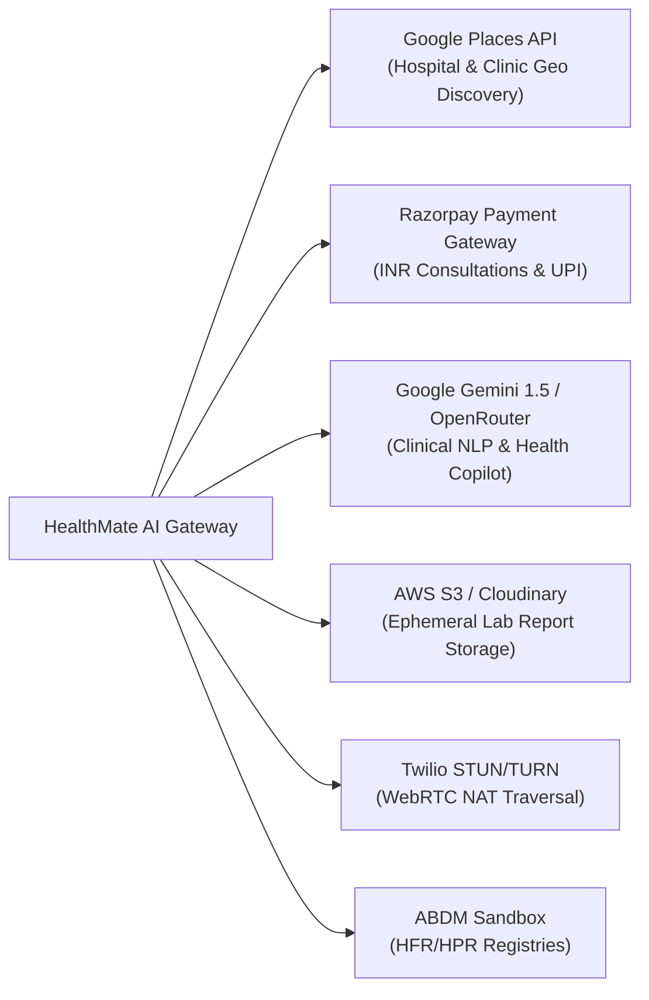

# HealthMate AI - Master External Integration Requirements Specification
**Document Version:** 1.0.0  
**Phase:** Phase 0 - Master Architecture, Requirements Analysis & Development Planning  
**Execution Scope:** API Keys, Managed Infrastructure, Environment Variables & Credential Setup  

---

## 1. External Integration Overview & Dependency Matrix

HealthMate AI interfaces with dedicated third-party platforms for cloud infrastructure, geolocation discovery, telemedicine media relay, and payment processing:



---

## 2. Detailed Service Specifications

### 2.1 Google Places API (New)
- **Domain:** Automated India-wide and nearby discovery of hospitals, clinics, diagnostic centers, and pharmacies.
- **Provider:** Google Cloud Platform (GCP).
- **Required Credentials:**
  - `GOOGLE_PLACES_API_KEY`: API Key with restriction to Places API (New) and Geocoding API.
- **Environment Variables:**
  ```env
  GOOGLE_PLACES_API_KEY="AIzaSyB..."
  GOOGLE_MAPS_REGION="in"
  ```
- **Fallback Protocol:** If Google Places quota is exhausted or unavailable, query existing source-verified facilities cached in MongoDB within the bounding box.

---

### 2.2 Razorpay Payment Gateway
- **Domain:** Teleconsultation fee collection, refunds, and doctor payout reconciliation (INR, UPI, NetBanking, Cards).
- **Provider:** Razorpay Software Pvt. Ltd. (India).
- **Required Credentials:**
  - `RAZORPAY_KEY_ID`: Public Key ID (`rzp_test_...` in dev; `rzp_live_...` in prod).
  - `RAZORPAY_KEY_SECRET`: Private Secret Key.
  - `RAZORPAY_WEBHOOK_SECRET`: HMAC Secret for validating webhook events (`payment.captured`, `refund.processed`).
- **Environment Variables:**
  ```env
  RAZORPAY_KEY_ID="rzp_test_xxxxxxx"
  RAZORPAY_KEY_SECRET="yyyyyyyyyyyyyyy"
  RAZORPAY_WEBHOOK_SECRET="whsec_zzzzzz"
  ```
- **Webhook Endpoint:** `POST /api/v1/payments/razorpay-webhook`

---

### 2.3 Large Language Model Gateway (OpenRouter Primary + Google Gemini Fallback)
- **Domain:** AI Health Copilot conversational assistance, medical RAG synthesis, clinical note generation (SOAP), and multilingual patient interaction.
- **Provider Architecture:** 
  - **Primary Gateway:** OpenRouter (accessing top-tier medical and conversational LLMs with configurable models).
  - **Fallback Provider:** Google Gemini API (automatic failover if OpenRouter experiences timeouts, rate limits, or errors).
  - **Resilience:** Provider health checks, configurable timeouts (default 10s), exponential backoff retries (max 2 retries), and seamless automatic fallback.
- **Environment Variables:**
  ```env
  # Primary Provider (OpenRouter)
  OPENROUTER_API_KEY="sk-or-v1-..."
  OPENROUTER_MODEL_NAME="anthropic/claude-3.5-sonnet"
  OPENROUTER_BASE_URL="https://openrouter.ai/api/v1"

  # Fallback Provider (Google Gemini)
  GEMINI_API_KEY="AIzaSy..."
  GEMINI_MODEL_NAME="gemini-1.5-flash"

  # Gateway Configuration
  LLM_PRIMARY_PROVIDER="openrouter"
  LLM_FALLBACK_PROVIDER="gemini"
  LLM_TIMEOUT_SECONDS=10
  LLM_MAX_RETRIES=2
  ```
- **Security:** All API keys remain strictly server-side on the backend/AI microservice. Never exposed to frontend clients. Guardrails include pre-prompt injection defense, strict non-diagnostic clinical boundaries, and explicit safety filters.

---

### 2.4 Temporary Object Storage (AWS S3 / Cloudinary)
- **Domain:** Secure, temporary staging of uploaded pathology lab reports and doctor verification certificates.
- **Provider:** AWS S3 (Mumbai `ap-south-1`) or Cloudinary.
- **Required Credentials:**
  - `AWS_ACCESS_KEY_ID`, `AWS_SECRET_ACCESS_KEY`, `AWS_REGION`, `AWS_S3_BUCKET_NAME`.
- **Ephemeral Rule Configuration:**
  - Presigned upload URLs with 5-minute validity.
  - Bucket Lifecycle Rule: Permanently delete objects tagged `ephemeral=true` after 24 hours.

---

### 2.5 WebRTC STUN/TURN Infrastructure
- **Domain:** Peer-to-peer audio/video teleconsultation stream traversal across symmetric NAT and hospital firewalls.
- **Provider:** Twilio Network Traversal Service or Xirsys ICE.
- **Required Credentials:**
  - `TWILIO_ACCOUNT_SID`, `TWILIO_AUTH_TOKEN`.
- **Configuration Pattern:**
  - Ephemeral ICE server credentials requested by client upon appointment room entry (`GET /appointments/:id/ice-credentials`).

---

### 2.6 Ayushman Bharat Digital Mission (ABDM) Sandbox
- **Domain:** Simulation of Health Facility Registry (HFR) and Healthcare Professional Registry (HPR).
- **Provider:** National Health Authority (NHA) Sandbox Portal.
- **Required Credentials:**
  - `ABDM_CLIENT_ID`, `ABDM_CLIENT_SECRET`.
- **Environment Variables:**
  ```env
  ABDM_BASE_URL="https://sandbox.abdm.gov.in"
  ABDM_CLIENT_ID="SBX_xxxx"
  ABDM_CLIENT_SECRET="yyyy"
  ```

---

## 3. Environment Variable Master Template (`.env.example`)

```env
# Server Configuration
NODE_ENV=development
PORT=5000
CLIENT_URL=http://localhost:5173

# Databases
MONGODB_URI=mongodb+srv://<user>:<password>@cluster0.mongodb.net/healthmate?retryWrites=true&w=majority
REDIS_URL=redis://default:<password>@redis-cluster-endpoint:6379

# JWT & Security
JWT_ACCESS_SECRET=super_secret_jwt_access_key_min_64_chars_length_here
JWT_REFRESH_SECRET=super_secret_jwt_refresh_key_min_64_chars_length_here
INTERNAL_SERVICE_SECRET=internal_hmac_sha256_shared_secret_between_node_and_python

# AI Microservice Internal Address
AI_SERVICE_URL=http://localhost:8000

# External APIs
GOOGLE_PLACES_API_KEY=AIzaSy...
RAZORPAY_KEY_ID=rzp_test_...
RAZORPAY_KEY_SECRET=...
RAZORPAY_WEBHOOK_SECRET=...
# LLM Configuration (OpenRouter Primary + Gemini Fallback)
LLM_PRIMARY_PROVIDER=openrouter
OPENROUTER_API_KEY=sk-or-v1-xxxxxxxxxxxxxxxxxxxx
OPENROUTER_MODEL_NAME=anthropic/claude-3.5-sonnet
OPENROUTER_BASE_URL=https://openrouter.ai/api/v1

LLM_FALLBACK_PROVIDER=gemini
GEMINI_API_KEY=AIzaSyxxxxxxxxxxxxxxxxxxxx
GEMINI_MODEL_NAME=gemini-1.5-flash

LLM_TIMEOUT_SECONDS=10
LLM_MAX_RETRIES=2

# Object Storage
AWS_REGION=ap-south-1
AWS_S3_BUCKET_NAME=healthmate-ephemeral-uploads
AWS_ACCESS_KEY_ID=...
AWS_SECRET_ACCESS_KEY=...
```
