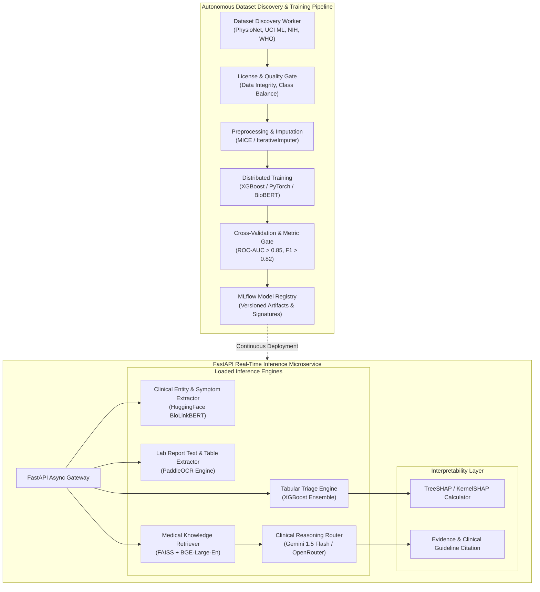
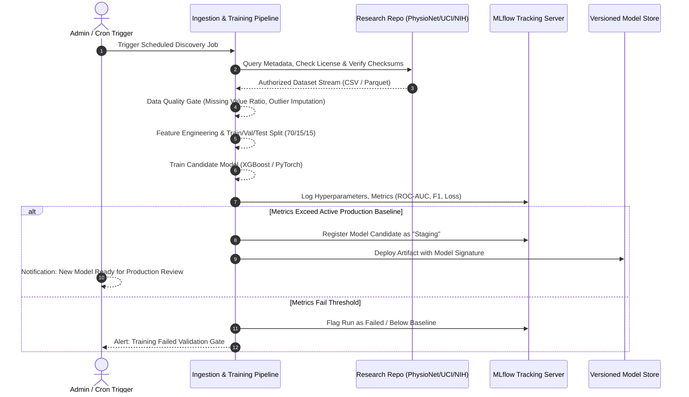

# HealthMate AI - Master Machine Learning & AI Architecture Specification
**Document Version:** 1.0.0  
**Phase:** Phase 0 - Master Architecture, Requirements Analysis & Development Planning  
**Execution Runtime:** Python 3.11, FastAPI, Uvicorn, PyTorch 2.2+, Scikit-learn, XGBoost, Hugging Face Transformers  
**MLOps Framework:** MLflow, DVC, FAISS, SHAP, PaddleOCR  

---

## 1. Machine Learning System Overview

HealthMate AI deploys a **Hybrid AI Engine** that marries the determinism and interpretability of tree-based ensembles with the linguistic and reasoning capabilities of Large Language Models and Deep Neural Networks. All medical predictions are explicitly calibrated with confidence intervals and feature attributions via Explainable AI (SHAP), adhering strictly to medical validation guidelines.

---

## 2. Core AI/ML Modules Breakdown

### 2.1 Patient AI: Intelligent Symptom Checker & Triage Classifier
- **Model Architecture:** Calibrated Gradient Boosted Decision Tree (XGBoost) combined with BioBERT clinical token extraction.
- **Input Features:**
  - One-hot / frequency encoded symptom indicators (Extracted via BioLinkBERT NLP entity recognition).
  - Continuous vital signs: Systolic BP, Diastolic BP, Heart Rate, SpO2, Blood Glucose, Body Temperature.
  - Demographic features: Age, Gender (where physiologically relevant).
  - Symptom chronicity: Duration (hours/days), self-reported severity index (1-10).
- **Output:**
  - Multi-class probability distribution across triage categories: `EMERGENCY_IMMEDIATE`, `URGENT_EVALUATION`, `ROUTINE_CONSULTATION`, `SELF_CARE_MONITOR`.
  - Confidence interval and prediction entropy.
- **Explainability:** SHAP (SHapley Additive exPlanations) values computed for top 5 contributing features, visualized as an intuitive impact waterfall chart on the patient UI.

### 2.2 Medical Report OCR & Document Intelligence
- **Model Architecture:** PaddleOCR v2 (Detection + Recognition) fine-tuned on standard Indian diagnostic laboratory templates (Thyrocare, Lal PathLabs, Apollo Diagnostics formats).
- **Processing Flow:**
  1. Image preprocessing: Deskewing, adaptive binarization, noise filtering.
  2. Text and table boundary detection.
  3. Key-Value biomarker association: Regular Expression and named-entity matcher linking biomarker name (e.g., "Hemoglobin", "HbA1c", "Serum Creatinine") with its numeric value, unit, and laboratory reference interval.
  4. Out-of-bounds anomaly flagging: Automatically highlights values exceeding reference intervals.

### 2.3 Medical Knowledge Retrieval-Augmented Generation (RAG)
- **Vector Database:** FAISS (Facebook AI Similarity Search) index operating in-memory on the Python service.
- **Embedding Model:** `BAAI/bge-large-en-v1.5` (1024-dimensional dense embeddings).
- **Knowledge Base Corpus:**
  - Standard National Treatment Guidelines (Government of India Ministry of Health & Family Welfare).
  - WHO Essential Medicines List & Clinical Guidelines.
  - PubMed open-access clinical literature abstracts.
- **Retrieval Mechanism:** Hybrid search combining BM25 keyword matching with FAISS cosine similarity dense retrieval.
- **LLM Gateway & Resilience:** Resilient dual-provider architecture using **OpenRouter** as the primary gateway (configurable models such as Anthropic Claude 3.5 Sonnet or Llama 3 70B) with automatic failover to **Google Gemini** (Gemini 1.5 Flash). Features active provider health checks, configurable timeouts (default 10s), exponential backoff retries, and safety guardrails forbidding direct prescription while enforcing medical citation references. All keys reside securely on the backend microservice.

### 2.4 Doctor AI: Clinical Copilot & Differential Diagnosis Support
- **SOAP Note Drafter:** Automatically summarizes patient-reported symptoms, uploaded lab findings, and consultation dialogue into Subjective, Objective, Assessment, and Plan (SOAP) clinical note format.
- **Drug-Drug Interaction (DDI) Engine:** Graph-based checker using authenticated RxNorm / DrugBank open dataset mapping active chemical compounds and warning against contraindications (e.g., Warfarin + Aspirin hemorrhage risk).
- **Doctor Review Gate:** AI-generated notes, differential suggestions, and prescription drafts are strictly advisory. The doctor must review, edit, and cryptographically sign before any artifact is finalized.

### 2.5 Administration AI: Fraud & Quality Assurance Engine
- **Doctor Credential OCR & Authenticity Verifier:** Scans uploaded medical certificates, matches text against NMC registration formats, and detects manipulation or forgery anomalies.
- **Payment & Booking Anomaly Detector:** Isolation Forest anomaly detector on transaction sequences to identify abusive booking patterns or fraudulent chargeback behavior.

---

## 3. Autonomous Dataset Pipeline & MLOps Architecture

To comply strictly with the requirement **"The developer must not manually upload or insert ML datasets"**, HealthMate AI implements automated dataset discovery, validation, and training pipelines.

### Data Quality & Preprocessing Standards
1. **Handling Missing Data:** No synthetic fabrication of patient data. For model training on verified research corpora, missing values are imputed using Multivariate Imputation by Chained Equations (MICE) or marked with explicit missingness indicators.
2. **Feature Drift & Model Monitoring:** Production inference payloads are periodically evaluated against training baseline distributions using the Kolmogorov-Smirnov (KS) test for continuous variables and Population Stability Index (PSI) for categorical variables. If PSI > 0.2, an administrative alert is generated for model retraining.

---

## 4. Explainable AI (XAI) Framework

In clinical environments, black-box decisions are unacceptable. HealthMate AI mandates:
1. **Local Interpretability:** Every triage recommendation is accompanied by TreeSHAP feature attributions detailing which specific physiological variables shifted the risk score towards the predicted class.
2. **Uncertainty Quantification:** Predictions output calibrated probabilities via Platt scaling or Isotonic Regression. If maximum class probability is below 0.60, the system outputs an explicit `UNCERTAINTY_FLAG: Specialist Consultation Strongly Recommended`.
3. **Mandatory Non-Diagnostic Disclaimer:** Every model response includes the standard clinical non-diagnostic disclaimer required by NMC guidelines.
