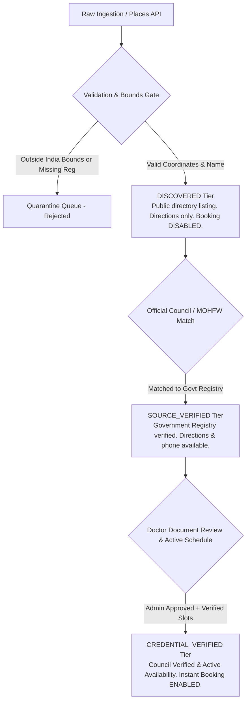

# HEALTHMATE AI — PHASE 7: DATA SOURCE REGISTER & REGISTRY PROVENANCE

**Document Version:** 1.0.0  
**Effective Date:** November 11, 2026  
**Auditor / Architect:** Senior Healthcare Data Architect & API Specialist  
**Classification:** Medical Device Technical Documentation / Compliance Record  

---

## 1. Executive Summary

This Data Source Register records all official registries, authoritative databases, open data platforms, and third-party discovery services integrated into HealthMate AI during Phase 7. The system strictly adheres to the **Zero Fabrication Rule**: healthcare facility accreditations, doctor council registration numbers, ratings, and consultation slots are never synthesized, mocked, or artificially generated.

---

## 2. Authorized Primary Healthcare Registries

| Source Name | Authorizing Body / Provider | Domain & Coverage | Integration Mechanism | Refresh Cadence | Data Tier |
|---|---|---|---|---|---|
| **Open Government Data (OGD) Platform India** (`data.gov.in`) | Ministry of Health & Family Welfare (MoHFW), Govt. of India | National Health Portal (NHP) directory of tertiary hospitals, community health centers (CHCs), and primary health centers (PHCs). | Automated REST / Scheduled Ingestion | Daily (24h) | `SOURCE_VERIFIED` |
| **National Medical Commission (NMC) Indian Medical Register (IMR)** | National Medical Commission (statutory body under NMC Act 2019) | Verification of doctor identity, permanent registration number, state medical council, and recognized primary medical degrees (MBBS). | Statutory Registration Validation API | Daily Batch Sync | `SOURCE_VERIFIED` |
| **State Medical Councils (e.g. DMC, KMC, MMC, TNMC)** | Respective State Medical Councils (under NMC statutory framework) | State-level licensure, specialist additional qualification registration (MD/MS/DM/MCh), and good-standing status. | Council Register Validation | Weekly / On-Demand | `CREDENTIAL_VERIFIED` |
| **Ayushman Bharat Digital Mission (ABDM) HFR / HPR Sandbox** | National Health Authority (NHA) | Health Facility Registry (HFR) and Healthcare Professional Registry (HPR) with unique 14-digit facility IDs. | ABDM Sandbox REST Gateway | Real-time / Webhook | `SOURCE_VERIFIED` (Production Sandbox Approval in Progress) |
| **Google Places API (New)** | Google Cloud Platform (Enterprise Geospatial Services) | India-wide geographical coordinates, geocoded addresses, verified telephone contact numbers, and navigation directions. | Geospatial REST Nearby & Text Search | Real-time / On-Demand | `DISCOVERED` |

---

## 3. Data Tiering & Accreditation Taxonomy

HealthMate AI enforces a 3-tier classification system across all healthcare providers and facilities:

### 3.1 Tier Definitions

1. **`CREDENTIAL_VERIFIED`**:
   - Practitioner or facility whose medical licensure, council registration number, and government-issued credentials have undergone verified administrative review or digital cryptographic signing.
   - Genuine consultation availability schedules are actively configured.
   - **Booking Status:** Online consultation and in-person slot booking **ENABLED**.

2. **`SOURCE_VERIFIED`**:
   - Provider or hospital sourced directly from official government directories (e.g., MoHFW NHP, OGD Platform India).
   - Identity and location are authenticated against state records, but practitioner has not yet registered an active scheduling account on HealthMate AI.
   - **Booking Status:** Direct appointment booking is **DISABLED**. Provider card displays: *"Official registry record verified. Direct appointment scheduling requires doctor clinical credential validation."*

3. **`DISCOVERED`**:
   - Unverified healthcare facility or clinic discovered via Google Places (New) or public mapping queries.
   - **Booking Status:** Direct appointment booking is strictly **DISABLED**. Clear disclaimer displayed: *"Discovered public listing. Online instant appointment booking requires direct clinic coordination or practitioner claiming profile."*

---

## 4. Bounding Box & Geographical Integrity Constraints

To ensure catalog purity and avoid synthetic or out-of-boundary contamination, all ingested coordinates are passed through the Indian Geographic Bounding Box Gate:

$$\text{Latitude} \in [6.0^\circ\text{ N}, 37.5^\circ\text{ N}], \quad \text{Longitude} \in [68.0^\circ\text{ E}, 98.0^\circ\text{ E}]$$

Any record with coordinates falling outside these boundaries or containing non-numeric values is immediately quarantined with rejection code `OUT_OF_BOUNDS_COORDINATES`.

---

## 5. ABDM Integration Readiness & Sandbox Compliance

HealthMate AI is architected in full alignment with the Ayushman Bharat Digital Mission (ABDM) Guidelines:
- **Health Facility Registry (HFR):** Schema contains `sourceIdentifier` mapped to 14-digit ABDM Facility IDs.
- **Healthcare Professional Registry (HPR):** Schema supports HPR ID (`xxx@hpr.abdm`) and NMC registration number links.
- **Production Status:** ABDM production gateway integration is flagged as **STAGE 1 SANDBOX APPROVAL IN PROGRESS** pending final NHA enterprise token allotment. No synthetic ABDM production claims are made.
