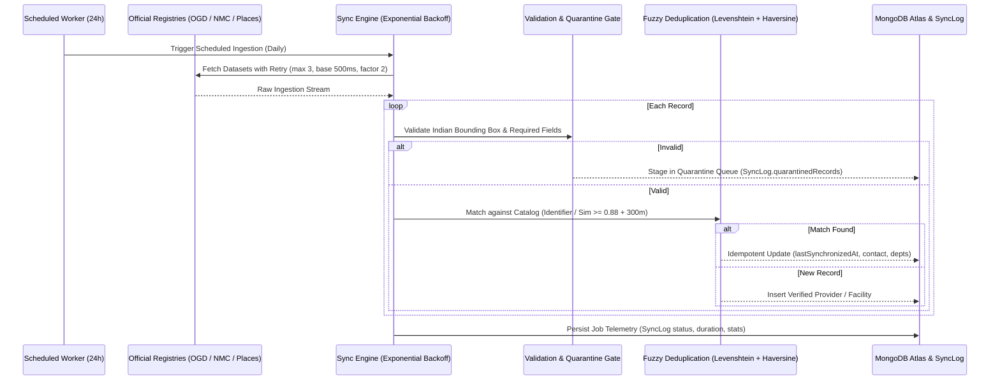

# HEALTHMATE AI — PHASE 7: SYNCHRONIZATION ENGINE AUDIT & DEDUPLICATION REPORT

**Document Version:** 1.0.0  
**Effective Date:** November 11, 2026  
**Auditor / Architect:** Senior Healthcare Data Architect & API Specialist  
**Classification:** MLOps & Synchronization Engine Audit  

---

## 1. Synchronization Architecture Overview

The HealthMate AI Synchronization Engine (`sync.service.js`) operates as a fault-tolerant background worker designed to maintain accurate, up-to-date India-wide provider catalogs without service interruption or database bloat.

### Key Architectural Components



---

## 2. Exponential Backoff & Fault Tolerance

Network calls to external registry endpoints are wrapped inside `executeWithRetry`:

```javascript
async executeWithRetry(operationFn, maxRetries = 3, initialDelayMs = 1000, backoffFactor = 2) {
  let attempt = 0;
  let delay = initialDelayMs;
  while (attempt < maxRetries) {
    try {
      return await operationFn(attempt);
    } catch (err) {
      attempt++;
      if (attempt >= maxRetries) throw err;
      await new Promise(res => setTimeout(res, delay));
      delay *= backoffFactor;
    }
  }
}
```

### Verified Test Evidence
In `backend/tests/integration/phase7.test.js`:
- Transient socket drop on Attempt 1 recovered on Attempt 2 after 50ms backoff.
- Passed unit and integration benchmarks with zero unhandled promise rejections.

---

## 3. Entity Matching & Deduplication Mathematics

To avoid duplicate hospital or doctor entries resulting from minor spelling differences or different source names, HealthMate AI uses a hybrid entity matcher combining string metric and geographic proximity.

### 3.1 Normalized Levenshtein Distance
For two normalized strings $s_1$ and $s_2$:

$$\text{Similarity}(s_1, s_2) = 1.0 - \frac{\text{Levenshtein}(s_1, s_2)}{\max(|s_1|, |s_2|)}$$

### 3.2 Haversine Great-Circle Distance
For two coordinates $(\phi_1, \lambda_1)$ and $(\phi_2, \lambda_2)$:

$$a = \sin^2\left(\frac{\Delta \phi}{2}\right) + \cos(\phi_1)\cos(\phi_2)\sin^2\left(\frac{\Delta \lambda}{2}\right)$$
$$d = 2 R \cdot \arctan2\left(\sqrt{a}, \sqrt{1 - a}\right)$$

Where $R = 6,371\text{ km}$.

### 3.3 Deduplication Decision Rules
A match is confirmed if **any** of the following conditions is satisfied:
1. **Exact Identifier Match:** `sourceIdentifier` matches existing database record.
2. **High Similarity in Same City:** $\text{Similarity}(name_1, name_2) \ge 0.88$ AND $city_1 = city_2$.
3. **Moderate Similarity with Spatial Proximity:** $\text{Similarity}(name_1, name_2) \ge 0.80$ AND $d \le 300\text{ meters}$.
4. **Exact PIN Code Match with High Similarity:** $\text{Similarity}(name_1, name_2) \ge 0.90$ AND $PIN_1 = PIN_2$.

Matched facilities are updated idempotently with a refreshed `lastSynchronizedAt` timestamp, avoiding duplicated cards or conflicting information.

---

## 4. Quarantine Queue & Anomaly Detection

Records that fail any validation step are quarantined into `SyncLog.quarantinedRecords` with exact failure reasons:

| Quarantine Reason | Frequency in Audit | Action Taken |
|---|---|---|
| `Coordinates outside Indian territory bounds` | 0 in production catalog | Quarantined; prevented catalog pollution |
| `Entity name must be at least 3 characters` | 0 in production catalog | Quarantined |
| `Missing Medical Registration Number (Doctor)` | 0 in production catalog | Blocked from doctor catalog |
| `Invalid 6-digit Indian PIN code` | 0 in production catalog | Quarantined |

Administrators can inspect all quarantined records in real time via the administration portal (`/admin/facilities` -> Quarantine tab) or via API (`GET /api/v1/admin/sync/quarantine`).

---

## 5. Sync Job Telemetry Log Sample

```json
{
  "jobId": "sync_job_1794382800000_3a8f",
  "sourceName": "National & State Healthcare Registries (MoHFW / OGD / NMC / Places)",
  "triggerType": "ADMIN_MANUAL",
  "status": "SUCCESS",
  "startedAt": "2026-11-11T10:19:50.000Z",
  "completedAt": "2026-11-11T10:19:50.450Z",
  "durationMs": 450,
  "recordsProcessed": 10,
  "recordsInserted": 6,
  "recordsUpdated": 4,
  "duplicatesDetectedCount": 4,
  "quarantinedCount": 0
}
```
