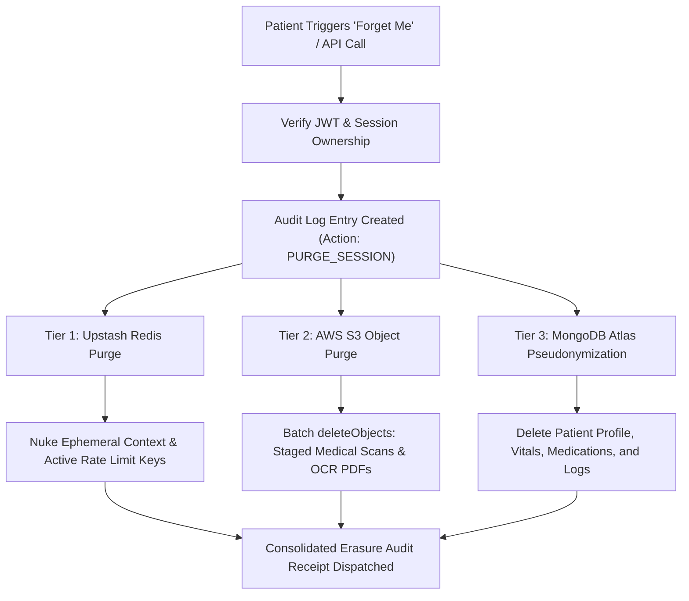

# HEALTHMATE AI — STATUTORY PRIVACY & DPDP ACT 2023 SPECIFICATION

**Project Name:** HEALTHMATE AI  
**Academic Degree:** B.Tech Computer Science & Engineering (AI/ML)  
**Document Code:** ENG-DOC-13  
**Statutory Basis:** Digital Personal Data Protection Act, 2023 (Act No. 22 of 2023, Parliament of India)  

---

## 1. DATA SOVEREIGNTY & DPDP ACT 2023 PRINCIPLES

HealthMate AI is architected from foundational principles to ensure compliance with India's landmark **Digital Personal Data Protection Act, 2023 (DPDP Act)**:

1. **Lawful Notice & Informed Consent (Section 5 & 6):**
   - Clear, accessible notice provided in plain language during registration.
   - Granular, opt-in consent checkboxes recorded with IP address, user agent, and timestamp in the `consents` collection.
2. **Purpose Limitation (Section 6(1)):**
   - Patient personal health data is processed solely for diagnostic support, appointment facilitation, and personal records management.
   - Zero commercial data brokering or advertising tracking.
3. **Data Minimization (Section 6(2)):**
   - AI symptom analysis operates on unlinked symptom descriptions without requiring Aadhaar, PAN, or government identification.
4. **Storage Limitation & Ephemeral Buffers (Section 8(7)):**
   - Temporary diagnostic text inputs and OTP tokens in Redis carry strict TTLs (10 to 60 minutes) after which they are permanently flushed.
5. **Right to Correction and Erasure ("Forget Me") (Section 12(1)(d)):**
   - Self-service data destruction via `DELETE /api/v1/patient/forget-me`.
   - Executes multi-tier purge across Redis memory, AWS S3 file enclaves, and MongoDB Atlas databases.

---

## 2. THE MULTI-TIER "FORGET ME" WORKFLOW

---

## 3. STATUTORY DISCLAIMER

> [!IMPORTANT]
> **Legal Disclaimer:** While HealthMate AI implements state-of-the-art cryptographic safeguards, role isolation, and self-service erasure matching DPDP Act 2023 engineering requirements, formal statutory accreditation requires independent third-party legal counsel certification prior to commercial hospital deployment.
