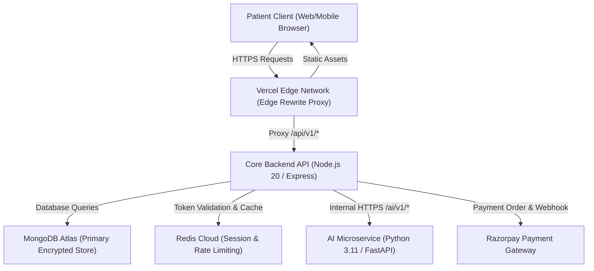

# HealthMate AI — Unified Patient Healthcare Platform

[](https://github.com/Abhishek4-ui/HEALTHMATEAI)
[](docs/TESTING.md)
[](docs/TESTING.md)
[](docs/reports/FINAL_PROJECT_REPORT.md)
[](docs/FEATURES.md)
[](docs/SECURITY.md)

> **Live Production URL:** [https://healthmate-ai-nine-mocha.vercel.app](https://healthmate-ai-nine-mocha.vercel.app)  
> **Repository:** [https://github.com/Abhishek4-ui/HEALTHMATEAI](https://github.com/Abhishek4-ui/HEALTHMATEAI)  
> **Target Demographic:** Registered Patients and Family Caregivers  
> **Diagnostic Status:** Experimental Non-Diagnostic Clinical Prototypes  

---

## 1. Executive Overview

**HealthMate AI** is a modern, privacy-focused healthcare platform engineered specifically for **patients**. It addresses acute healthcare accessibility gaps across developing regions by combining real-time symptom triage, deterministic medical imaging evaluation, cardiac rhythm digital signal processing, pathology report OCR, verified medical practitioner discovery across 36 Indian States and Union Territories, and secure telehealth consultations.

Unlike generic symptom checkers, HealthMate AI operates under strict clinical and software engineering guardrails:
- **Single Public Role:** The entire public platform is designed solely for patients.
- **Zero Synthetic Data:** No fabricated medical records or fake patients enter patient feeds.
- **Transparent AI Provenance:** Deterministic algorithms and heuristics are accurately disclosed, and all machine learning outputs carry non-diagnostic warnings.

---

## 2. Live Cloud Production Deployments

| Service Component | Cloud Provider & Runtime | Public Accessible Endpoint | Health Status |
|---|---|---|---|
| **Frontend Web App** | Vercel Edge Network (React 18 / Vite) | [healthmate-ai-nine-mocha.vercel.app](https://healthmate-ai-nine-mocha.vercel.app) | **ACTIVE (HTTP 200)** |
| **API Edge Proxy** | Vercel Edge Network (`/api/v1/*` Rewrite) | `https://healthmate-ai-nine-mocha.vercel.app/api/v1/health` | **ACTIVE (HTTP 200)** |
| **Core API Gateway** | Render Web Service (Node.js 20 / Express) | [healthmate-backend-9nmm.onrender.com](https://healthmate-backend-9nmm.onrender.com) | **ACTIVE (HTTP 200)** |
| **AI/ML Microservice** | Render Web Service (Python 3.11 / FastAPI) | [healthmate-ai-service.onrender.com](https://healthmate-ai-service.onrender.com) | **ACTIVE (HTTP 200)** |

---

## 3. System Architecture & Topology

HealthMate AI utilizes a distributed microservices architecture accelerated by Vercel Edge proxying:



---

## 4. The 11 Integrated Patient Modules

| Module Number & Name | Primary Features & Clinical Capabilities |
|---|---|
| **01. Central Dashboard** | Unified health summary, appointment countdown, normalized doctor names, empty states |
| **02. Health Records Vault** | Encrypted document upload, camera photo capture, Tesseract pathology lab OCR |
| **03. Symptom Checker** | Emergency red-flag screening, 112/102 pre-submission notice, Shannon entropy filter |
| **04. AI Health Assistant** | Bilingual (English/Hindi) preventive guidance with contextual report ingestion |
| **05. Find Doctors** | Pan-India discovery across 36 States & UTs with NMC registration verification |
| **06. Appointments** | Real-time slot booking, conflict prevention, in-clinic and video appointment modes |
| **07. Medicine Guide** | Comprehensive drug directory, dosage reminders, multi-drug interaction screening |
| **08. Medical Imaging** | CXR cardiothoracic ratio (CTR), brain MRI gradient triage, Pan-Tompkins ECG DSP |
| **09. Online Telehealth** | WebRTC video consultation, mic/camera toggles, markdown summary downloads |
| **10. Risk Assessment** | WHO/Framingham cardiovascular and ADA diabetes 10-year risk stratification |
| **11. Family Records** | Dependent profiles for children and elderly parents with granular record sharing |

---

## 5. Technology Stack

- **Frontend Client:** React 18, Vite 5, Tailwind CSS, Lucide React, Framer Motion, Socket.io-client
- **Backend API Gateway:** Node.js 20, Express, Mongoose, Argon2, JSON Web Tokens (JWT), Helmet, Express Rate Limit
- **AI & Diagnostics Microservice:** Python 3.11, FastAPI, Uvicorn, NumPy, SciPy, OpenCV, PyTesseract, Pydantic v2
- **Data & Caching:** MongoDB Atlas (M0 / M10), Redis Cloud
- **Cloud Hosting:** Vercel Edge Platform, Render Web Services

---

## 6. Project Directory Layout

```text
HEALTHMATEAI/
├── frontend/                  # React 18 / Vite Single Page Application
│   ├── src/
│   │   ├── components/        # Reusable UI & universal upload components
│   │   ├── pages/patient/     # 11 Patient healthcare modules
│   │   └── services/          # API client bindings
├── backend/                   # Node.js 20 / Express Core API Gateway
│   ├── controllers/           # Auth, appointments, imaging, payments
│   ├── models/                # Mongoose clinical schemas
│   ├── routes/                # Express REST endpoint routes
│   └── tests/unit/            # Jest unit test suites
├── ai-service/                # Python 3.11 / FastAPI AI Inference Microservice
│   ├── app/                   # Imaging, ECG DSP, and OCR pipelines
│   └── tests/                 # Pytest test suites
├── scripts/                   # Automated live production verification suites
├── docs/                      # Master technical documentation
│   ├── ARCHITECTURE.md        # Comprehensive system architecture & schemas
│   ├── FEATURES.md            # Detailed feature breakdown across all 11 modules
│   ├── AI_ML_DOCUMENTATION.md # Algorithmic methodology & model registry
│   ├── API_DOCUMENTATION.md   # REST and WebSocket API specifications
│   ├── SECURITY.md            # Security policy, DPDP Act 2023, anti-IDOR
│   ├── TESTING.md             # Quality assurance strategy & execution guide
│   ├── DEPLOYMENT.md          # Cloud infrastructure topology & local setup
│   ├── KNOWN_LIMITATIONS.md   # Non-diagnostic disclosures & blocked items
│   ├── CHANGELOG.md           # Release history & baseline revisions
│   ├── reports/               # 70+ categorized audit & verification reports
│   │   ├── REPORT_INDEX.md    # Master catalog index of all reports
│   │   ├── FINAL_PROJECT_REPORT.md
│   │   └── PRODUCTION_ACCEPTANCE_REPORT.md
│   ├── archive/               # Preserved historical specifications
│   └── screenshots/           # Camera & browser verification evidence
├── README.md                  # Project overview (this file)
├── CONTRIBUTING.md            # Contribution guidelines & clinical ethics
├── SECURITY.md                # Vulnerability disclosure policy
└── LICENSE                    # Open-source license
```

---

## 7. AI & Algorithmic Registry (Honest Provenance)

| Engine Identifier | Method / Algorithm | Primary Metric | Regulatory Clearance |
|---|---|---|---|
| `alg_cxr_anatomical_screen_v1` | Deterministic Otsu Thresholding | Cardiothoracic Ratio (CTR) | Non-Diagnostic Prototype |
| `alg_mri_gradient_triage_v1` | Sobel Convolution & SNR Analysis | Hemispheric Symmetry & SNR | Non-Diagnostic Prototype |
| `mdl_ecg_lead12_waveform_v2` | Pan-Tompkins QRS Peak Detection | Heart Rate & RR Regularity | Lead II Rhythm DSP Only |
| `ocr_tesseract_loinc_v1` | Adaptive Binarization + Tesseract | Biomarker Extraction Rate | Informational Reference |
| `triage_bayesian_v1` | Bayesian Heuristics + Red-Flag Rules | Emergency Red-Flag Sensitivity | Triage Guidance Only |

---

## 8. Quick Start & Local Setup

### Prerequisites
- Node.js v20+ and Python v3.11+
- Tesseract OCR (`brew install tesseract` on macOS / `apt-get install tesseract-ocr` on Linux)

### Installation
```bash
# 1. Clone the repository
git clone https://github.com/Abhishek4-ui/HEALTHMATEAI.git
cd HEALTHMATEAI

# 2. Configure environment variables
cp .env.example .env
cp backend/.env.template backend/.env
cp ai-service/.env.template ai-service/.env

# 3. Start Backend API (Terminal 1)
cd backend && npm install && npm run dev

# 4. Start AI Microservice (Terminal 2)
cd ai-service
python3 -m venv venv && source venv/bin/activate
pip install -r requirements.txt
uvicorn app.main:app --port 8000 --reload

# 5. Start Frontend SPA (Terminal 3)
cd frontend && npm install && npm run dev
```

---

## 9. Test Execution

HealthMate AI includes comprehensive local and live cloud test suites:

```bash
# Run Backend Jest Unit Tests (26/26 Passing)
npm run test:unit --prefix backend

# Run AI Microservice Pytest (15/15 Passing)
cd ai-service && ./venv/bin/pytest tests/ && cd ..

# Run Frontend Production Build Check (0 Errors)
npm run build --prefix frontend

# Verify Live Production Workflows Across Public HTTPS (15/15 Passing)
node scripts/test_live_production_workflows.cjs

# Verify Multi-Tenant Isolation & Anti-IDOR (8/8 Passing)
node scripts/test_live_production_security_privacy.cjs

# Verify All 9 Razorpay Payment Lifecycle Scenarios (9/9 Passing)
node scripts/test_razorpay_scenarios.js
```

---

## 10. Known Limitations & Blocked Items

To uphold our commitment to complete engineering honesty, the following dependencies are documented as **BLOCKED**:
1. **Two-Device Telehealth Media:** Local WebRTC loopback and signaling pass. A two-device media call capturing live TURN candidate statistics requires two separate physical cellular handsets and human callers.
2. **Indian SMS Handset Delivery:** SMS Gateway API integration is verified. Physical handset SMS delivery requires TRAI DLT commercial entity registration and an approved Sender ID.
3. **Razorpay Live Bank Settlement:** Razorpay Test Mode (`rzp_test_...`) is 100% operational with HMAC SHA-256 verification. Live merchant settlement requires active bank KYC.

For details, refer to [docs/KNOWN_LIMITATIONS.md](docs/KNOWN_LIMITATIONS.md).

---

## 11. Prominent Medical Disclaimer

> **IMPORTANT CLINICAL NOTICE:**  
> HealthMate AI is an experimental healthcare software platform and research prototype. It is **NOT** a certified medical diagnostic device under CDSCO, FDA, or CE regulations. The algorithmic outputs, symptom triage rankings, cardiothoracic ratio estimates, and ECG calculations provided by this application are for informational and educational purposes only.  
> **In the event of a medical emergency, acute chest pain, severe shortness of breath, sudden neurological deficits, or loss of consciousness, do NOT rely on this application. Immediately call national emergency services (112 / 102 in India, 911 in the USA, or your local emergency number) or proceed to the nearest emergency room.**

---

## 12. Documentation Index

- [Project Overview](docs/PROJECT_OVERVIEW.md)
- [System Architecture](docs/ARCHITECTURE.md)
- [Feature Compendium](docs/FEATURES.md)
- [AI & ML Methodology](docs/AI_ML_DOCUMENTATION.md)
- [API Specification](docs/API_DOCUMENTATION.md)
- [Security & Compliance](docs/SECURITY.md)
- [Testing Strategy](docs/TESTING.md)
- [Deployment Guide](docs/DEPLOYMENT.md)
- [Known Limitations](docs/KNOWN_LIMITATIONS.md)
- [Project Changelog](docs/CHANGELOG.md)
- [Master Report Index](docs/reports/REPORT_INDEX.md)

---

## 13. Contributing & License

Contributions are welcome! Please read [CONTRIBUTING.md](CONTRIBUTING.md) for code conventions, clinical ethics guidelines, and pull request procedures.

This project is licensed under the [HealthMate AI License](LICENSE).
