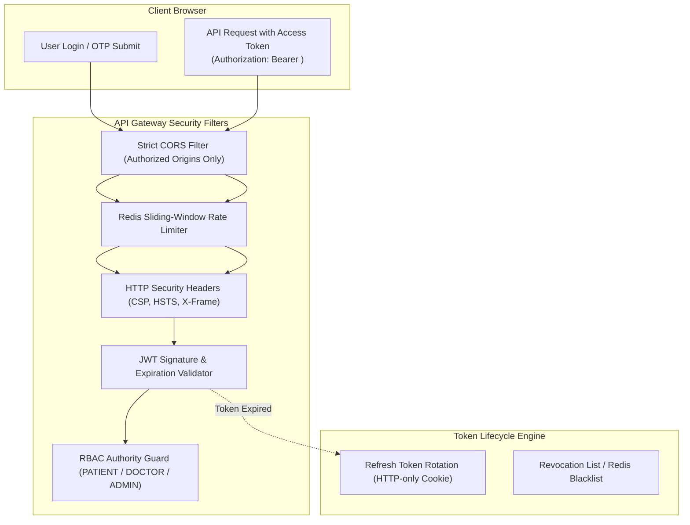

# HealthMate AI - Master Cybersecurity & Compliance Architecture
**Document Version:** 1.0.0  
**Phase:** Phase 0 - Master Architecture, Requirements Analysis & Development Planning  
**Standards:** OWASP Top 10 API Security, CERT-In Cyber Security Directions, DPDP Act 2023, ISO/IEC 27001  

---

## 1. Authentication, Identity & Session Security



### 1.1 Password Hashing & Secret Storage
- **Algorithm:** Argon2id (`memoryCost: 65536, timeCost: 3, parallelism: 4`) or Bcrypt (Cost Factor 12).
- **Secrets Management:** Zero hardcoded keys in source code. All secrets (`JWT_SECRET`, `REDIS_URL`, `MONGO_URI`, `RAZORPAY_SECRET`, `GEMINI_API_KEY`) are injected at runtime via environment variables managed by Doppler / Render Secret Manager.

### 1.2 Dual Token Lifecycle
- **Access Tokens:** Signed with HMAC-SHA256 (`HS256`) or asymmetric `RS256`. Expiration: 15 minutes. Contains `{ userId, role, isVerified }`.
- **Refresh Tokens:** High-entropy cryptographically random string (256-bit). Stored hashed in MongoDB with automatic rotation upon each refresh call. Expiration: 7 days. Stored strictly in `SameSite=Strict; Secure; HttpOnly` cookies.

---

## 2. Role-Based Access Control (RBAC) Enforcement Engine

The application enforces strict role segregation. Authorization middleware checks role metadata before any controller logic executes:

```javascript
// Express.js RBAC Guard Implementation Pattern
const authorizeRoles = (...allowedRoles) => {
  return (req, res, next) => {
    if (!req.user || !allowedRoles.includes(req.user.role)) {
      return res.status(403).json({
        success: false,
        error: "ACCESS_DENIED",
        message: "Your role does not have authorization to access this resource."
      });
    }
    next();
  };
};
```

---

## 3. Cryptography & Data Protection

### 3.1 Data in Transit
- Strict Transport Security (HSTS) with `max-age=31536000; includeSubDomains; preload`.
- Enforced TLS 1.3 across all client-to-backend and service-to-service connections.
- WebRTC media encryption: SRTP (Secure Real-time Transport Protocol) with DTLS (Datagram Transport Layer Security) key exchange.

### 3.2 Data at Rest
- **MongoDB Atlas:** Encrypted at rest via AWS KMS (AES-256).
- **Redis Cloud:** Encrypted storage engines with TLS in-flight encryption.
- **Object Storage:** AWS S3 server-side encryption with AWS KMS keys (`aws:kms`).

---

## 4. Service-to-Service Authentication (Node.js <-> FastAPI)

Internal communications between the Node.js backend and the Python AI service are authenticated using an HMAC signature scheme:
```
Signature = HMAC-SHA256(Timestamp + "." + RequestBody, INTERNAL_SHARED_SECRET)
```
- The FastAPI middleware recalculates the HMAC signature and rejects requests with timestamps older than 60 seconds (anti-replay protection).

---

## 5. Webhook Security & Payment Protection (Razorpay)

Payment callbacks from Razorpay are verified before updating any appointment state:
```javascript
const crypto = require('crypto');
const expectedSignature = crypto
  .createHmac('sha256', process.env.RAZORPAY_WEBHOOK_SECRET)
  .update(rawBody)
  .digest('hex');

if (expectedSignature !== req.headers['x-razorpay-signature']) {
  throw new Error('INVALID_PAYMENT_WEBHOOK_SIGNATURE');
}
```

---

## 6. Immutable Audit Trail & Threat Detection

All administrative decisions, doctor approvals, consent modifications, and credential updates emit immutable audit records:
```json
{
  "timestamp": "2026-11-10T15:30:00.000Z",
  "actorId": "6730ab9f1c4e7a892b10ef12",
  "actorRole": "ADMINISTRATION",
  "action": "APPROVE_DOCTOR_CREDENTIALS",
  "targetResource": { "type": "doctor_profiles", "id": "6730ab9f1c4e7a892b10ef19" },
  "ipAddress": "203.0.113.195",
  "userAgent": "Mozilla/5.0 ...",
  "statusCode": 200
}
```
Any brute-force login attempts or anomalous payload bursts trigger automatic IP bans via the Redis sliding-window filter.
