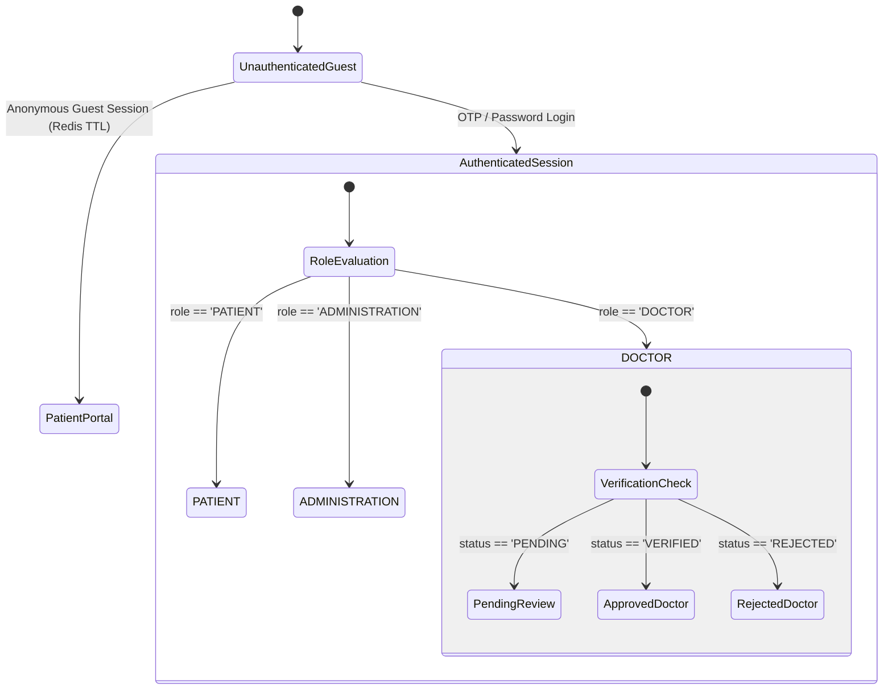
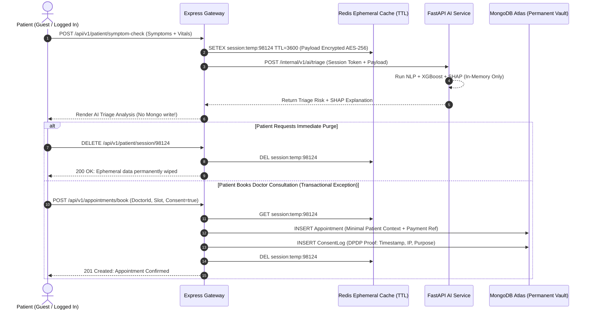
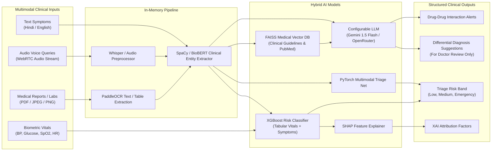
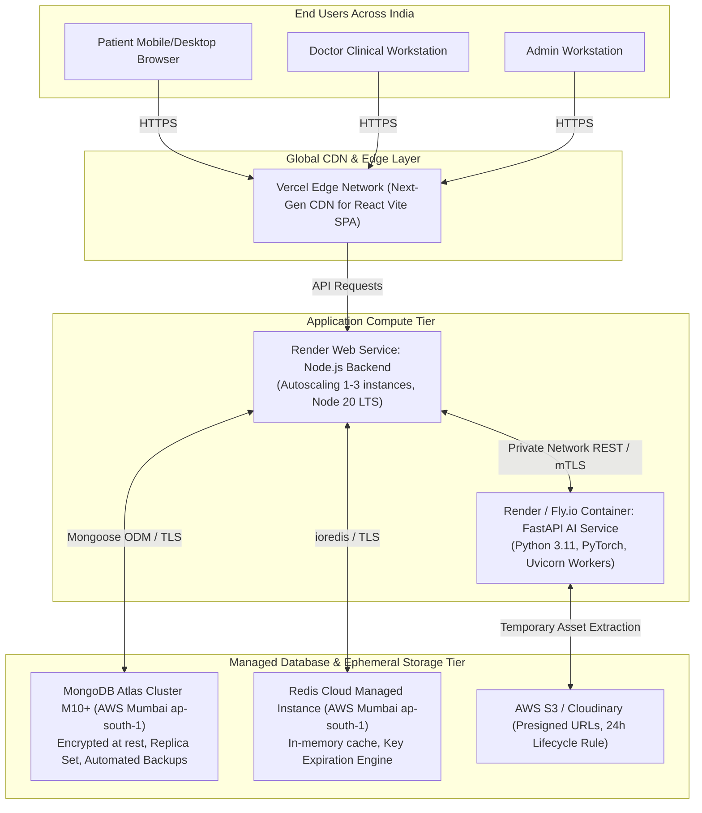

# HealthMate AI - Master System Architecture Specification
**Document Version:** 1.0.0  
**Phase:** Phase 0 - Master Architecture, Requirements Analysis & Development Planning  
**Classification:** Enterprise Healthcare Software Engineering Specification  
**Regulatory Baseline:** Digital Personal Data Protection Act (DPDP Act 2023 - India), National Digital Health Blueprint (NDHB), Ayushman Bharat Digital Mission (ABDM) Guidelines  

---

## 1. Executive Summary & Architectural Vision

**HealthMate AI** is an enterprise-grade, AI-powered healthcare ecosystem engineered to bridge the clinical, diagnostic, and logistical disconnect across the Indian healthcare continuum. Tailored specifically as an advanced BTech Computer Science & Engineering capstone project with AI & ML specialization, the platform integrates classical machine learning, deep learning, computer vision, natural language processing, retrieval-augmented generation (RAG), and explainable AI (XAI) within a high-performance MERN + FastAPI microservices paradigm.

### Fundamental System Principles
1. **Zero-Trust Patient Privacy & Ephemeral Data by Default:** All clinical consultations, symptom evaluations, triage outputs, uploaded lab reports, and AI dialogues persist strictly in volatile, memory-based temporary storage (Redis TTL) by default. Persistent storage in MongoDB is strictly limited to transactional ledgers (confirmed appointments, billing invoices, regulatory audit logs) or explicit, signed patient consent vaults.
2. **Tri-Role Boundary Enforcement:** The platform operates strictly under three, and *only* three, authenticated personas: **PATIENT**, **DOCTOR**, and **ADMINISTRATION**. No auxiliary or surrogate access tiers are permitted.
3. **Autonomous Verification & Discovery Pipeline:** Doctor, clinic, hospital, and pharmacy registries are automatically ingested, normalized, verified, and deduplicated from authoritative registries (Google Places API, ABDM Health Facility/Professional Registries, National Health Portal) without manual data fabrication.
4. **Verifiable MLOps Lifecycle:** Disease prediction, triage risk scoring, and medical report parsing operate on authentic datasets (PhysioNet, UCI ML Repository, NIH Clinical Center, WHO) with traceable feature extraction, cross-validation, MLflow tracking, SHAP explainability, and uncertainty bounds. Unvalidated black-box diagnoses are strictly prohibited.

---

## 2. Global High-Level Architecture Diagram

```mermaid
flowchart TB
    subgraph Client_Layer ["Client Presentation Tier (React.js + Vite + Tailwind CSS)"]
        P_UI["Patient Portal\n(Guest Session / Auth Vault)"]
        D_UI["Doctor Portal\n(Clinical Dashboard & WebRTC)"]
        A_UI["Administration Portal\n(Operations, MLOps, Audits)"]
    end

    subgraph Edge_Gateway ["Edge & API Gateway Tier (Render / Cloudflare)"]
        CF["Cloudflare Edge (WAF, SSL/TLS 1.3, DDoS Guard)"]
        GW["Express.js API Gateway & Reverse Proxy\n(Rate Limiting, JWT Auth, RBAC Engine)"]
    end

    subgraph Core_Backend ["Core Application Backend Tier (Node.js & Express.js)"]
        AUTH_SVC["Auth & Identity Service (JWT + OTP + RBAC)"]
        PATIENT_SVC["Patient Health Context & Session Manager"]
        DOCTOR_SVC["Doctor Credential & Availability Engine"]
        BOOKING_SVC["Appointment & Teleconsultation Dispatcher"]
        DISCOVERY_SVC["Geo & Facility Discovery Pipeline"]
        PAYMENT_SVC["Razorpay Payment & Ledger Service"]
        AUDIT_SVC["DPDP Audit Log & Compliance Engine"]
        WEBSOCKET["Socket.IO Signaling & Real-Time Sync"]
    end

    subgraph Ephemeral_Data ["Ephemeral Cache & Session Tier (Redis 7.x Managed)"]
        REDIS_SESSION["Temporary Guest Health Sessions\n(TTL: 30m - 24h)"]
        REDIS_CACHE["API Cache & Rate Limit Buckets"]
        REDIS_PUB_SUB["Pub/Sub & Real-Time Alert Bus"]
    end

    subgraph Persistent_Data ["Persistent Data Tier (MongoDB Atlas Replicas)"]
        MDB_USERS["User Accounts & Hashed Credential Vault"]
        MDB_PROFILES["Doctor Profiles & Verification Status"]
        MDB_TX["Transactional Ledgers (Appointments, Invoices)"]
        MDB_FACILITIES["Discovered & Verified Health Facilities"]
        MDB_CONSENT["Patient Consent Artifacts (DPDP Compliant)"]
        MDB_AUDIT["Immutable Audit Trails & Access Logs"]
    end

    subgraph AI_ML_Tier ["AI & Machine Learning Engine (Python & FastAPI Microservices)"]
        FASTAPI_ROUTER["FastAPI Gateway / Async Task Queue"]
        SYMPTOM_ENGINE["Symptom NLP & Multimodal Triage"]
        DISEASE_PREDICT["ML/DL Predictive Ensemble (XGBoost / PyTorch)"]
        VISION_OCR["PaddleOCR & Medical Report Analyzer"]
        XAI_ENGINE["SHAP / LIME Interpretability Engine"]
        RAG_CORE["Medical RAG Controller (FAISS + Embeddings)"]
        LLM_DISPATCH["Gemini 1.5 / OpenRouter Provider Dispatcher"]
        MLFLOW_SERVER["MLflow Model Registry & Drift Monitor"]
    end

    subgraph External_Integrations ["External Third-Party Ecosystem"]
        G_PLACES["Google Places API (Health Facilities)"]
        ABDM_API["ABDM Sandbox (HFR / HPR Registries)"]
        RAZORPAY_API["Razorpay Payment Gateway & Webhooks"]
        TWILIO_WEBRTC["STUN/TURN WebRTC Signaling Infrastructure"]
        S3_STORAGE["Encrypted Object Storage (Reports with TTL)"]
    end

    %% Client to Edge
    P_UI --> CF
    D_UI --> CF
    A_UI --> CF
    CF --> GW

    %% Gateway to Backend Services
    GW --> AUTH_SVC
    GW --> PATIENT_SVC
    GW --> DOCTOR_SVC
    GW --> BOOKING_SVC
    GW --> DISCOVERY_SVC
    GW --> PAYMENT_SVC
    GW --> AUDIT_SVC
    GW --> WEBSOCKET

    %% Ephemeral Connections
    PATIENT_SVC <--> REDIS_SESSION
    GW <--> REDIS_CACHE
    WEBSOCKET <--> REDIS_PUB_SUB

    %% Persistent Connections
    AUTH_SVC --> MDB_USERS
    DOCTOR_SVC --> MDB_PROFILES
    BOOKING_SVC --> MDB_TX
    DISCOVERY_SVC --> MDB_FACILITIES
    PATIENT_SVC --> MDB_CONSENT
    AUDIT_SVC --> MDB_AUDIT
    PAYMENT_SVC --> MDB_TX

    %% Backend to AI Tier
    PATIENT_SVC <-->|mTLS / Secure REST| FASTAPI_ROUTER
    DOCTOR_SVC <-->|mTLS / Secure REST| FASTAPI_ROUTER
    
    %% AI Tier Internal Dataflows
    FASTAPI_ROUTER --> SYMPTOM_ENGINE
    FASTAPI_ROUTER --> DISEASE_PREDICT
    FASTAPI_ROUTER --> VISION_OCR
    FASTAPI_ROUTER --> RAG_CORE
    DISEASE_PREDICT --> XAI_ENGINE
    RAG_CORE --> LLM_DISPATCH
    DISEASE_PREDICT --> MLFLOW_SERVER

    %% External Integrations
    DISCOVERY_SVC --> G_PLACES
    DISCOVERY_SVC --> ABDM_API
    PAYMENT_SVC --> RAZORPAY_API
    WEBSOCKET --> TWILIO_WEBRTC
    VISION_OCR --> S3_STORAGE
```



---

## 3. Microservice Decomposition & Communication Contracts

| Service Name | Primary Stack | Core Responsibility | Communication Protocol | Storage Engine |
| :--- | :--- | :--- | :--- | :--- |
| **Frontend Client WebApp** | React 18, Vite, Tailwind CSS, Framer Motion, Recharts | Unified responsive Single Page Application (SPA) serving Patient, Doctor, and Administration portals | HTTPS / WSS | Local Memory, Encrypted SessionStorage |
| **Node.js Core Backend Gateway** | Node.js 20 LTS, Express.js, Socket.IO | Routing, API Gateway, JWT Authentication, RBAC, Data Validation, WebSockets, Database CRUD | HTTPS, JSON REST, WebSocket | MongoDB Atlas & Redis |
| **Python AI/ML Microservice** | Python 3.11, FastAPI, Uvicorn, Celery/Asyncio | Multimodal symptom checker, OCR report parser, Disease risk prediction, Medical RAG, Explainable AI (SHAP) | mTLS Private REST, Asynchronous Tasks | Redis Queue, FAISS Vector Store, Disk Artifacts |
| **MLOps & Registry Service** | MLflow, Scikit-learn, PyTorch, XGBoost | Automated model evaluation, feature drift tracking, dataset registry, model checkpoints | Python SDK / MLflow HTTP Tracking API | Local Volume / Cloud Artifact Bucket |

### Inter-Service Communication Security
- **Node.js Backend to Python AI Service:** Communication takes place across an internal virtual private network (e.g., Render internal private network or Docker network bridge). All requests carry an internal HMAC-SHA256 signature in the `X-Internal-Service-Signature` header computed using a shared rotatable secret key `INTERNAL_SERVICE_SECRET`.
- **Client to Backend:** HTTP/2 over TLS 1.3 with standard JSON REST payloads, signed JWT access tokens (`Authorization: Bearer <token>`), and strict CORS headers whitelisting only authorized origins.

---

## 4. Application Roles & Access Control Boundary (Strict Tri-Role Model)



### Role Matrix & Responsibilities

1. **PATIENT (Role Code: `PATIENT`)**
   - **Access Rights:**
     - Access guest or authenticated health assessments.
     - Interact with AI Health Copilot (Multilingual: Hindi / English / Hinglish).
     - Submit multimodal symptom inputs (text, voice, image/vitals).
     - Upload medical reports for ephemeral OCR and extraction.
     - Search and discover verified doctors, clinics, hospitals, and pharmacies (India-wide & Geo-radius).
     - Book, reschedule, cancel teleconsultations or in-person visits.
     - Join peer-to-peer WebRTC video/audio consultation rooms.
     - View and download authorized digital prescriptions.
     - Track personal vitals (BMI, Blood Pressure, Glucose, SpO2, Heart Rate).
     - Exercise DPDP rights: Download Consent Report, Trigger Instant Session Purge.
   - **Restrictions:** Cannot view doctor clinical notes, cannot modify prescription catalogs, cannot access administration telemetry, cannot modify doctor verification state.

2. **DOCTOR (Role Code: `DOCTOR`)**
   - **Access Rights:**
     - Professional onboarding: Submit State Medical Council Registration Number, National Medical Commission (NMC) registration details, MBBS/MD degrees, ID proofs.
     - Manage clinical availability calendars, consultation fees, and appointment quotas.
     - Conduct WebRTC video/audio telemedicine consultations.
     - Access AI Clinical Copilot for consultation note drafting, differential diagnosis suggestions, drug-drug interaction warnings, and PubMed/guideline RAG retrieval.
     - Generate digitally signed e-prescriptions.
     - Access patient medical history *only* upon active consultation consent or authorized emergency bypass token.
     - Review earnings, payment remittances, and consultation analytics.
   - **Restrictions:** Unverified doctors (`status != 'VERIFIED'`) are locked in sandbox mode and cannot receive real bookings or appear in public discovery. Doctors cannot access admin system controls or other doctors' private clinical records.

3. **ADMINISTRATION (Role Code: `ADMINISTRATION`)**
   - **Access Rights:**
     - Global platform oversight: System health, active WebRTC rooms, API error rates.
     - Doctor credential verification pipeline: Inspect registration numbers against Indian State Medical Councils / NMC databases, verify degree certificates, approve/reject/suspend doctor accounts.
     - Hospital and clinic registry ingestion monitor (ABDM / Google Places sync jobs).
     - AI/ML Model Registry dashboard: Inspect model performance metrics (Accuracy, ROC-AUC, F1), monitor data drift, manage active model versions.
     - Financial oversight: Razorpay transaction ledger, payout schedules, commission rates, refund requests.
     - Compliance & Security: DPDP audit trail inspection, consent withdrawal monitoring, IP anomaly detection, incident response logs.
   - **Restrictions:** Administrators **never** have unencrypted access to private doctor-patient clinical consultations or raw video streams. All clinical data remains zero-knowledge encrypted. No fourth login role exists.

---

## 5. Ephemeral Patient Data & Zero-Trust Privacy Architecture

### Architecture Philosophy
Patient privacy in HealthMate AI is architected under the principle of **ephemeral by default**. When a patient inputs symptoms, speaks to the AI assistant, or uploads a blood test report:
1. The data is buffered solely in an encrypted Redis key with a defined Time-To-Live (TTL).
2. Processing (NLP extraction, OCR parsing, XGBoost risk evaluation) happens strictly in volatile execution memory.
3. The derived insights are transmitted back to the patient's client over TLS.
4. If the patient closes their session or clicks "Purge Session Data", the Redis key is deleted immediately (`DEL session:<id>`).
5. If no action is taken, the Redis TTL policy (default: 60 minutes for anonymous guests; 24 hours for active pre-consultation holding) automatically evicts the entire payload from memory.



---

## 6. Doctor and Healthcare Facility Automated Discovery Engine

To ensure compliance with the strict rule **"The developer must not manually insert doctor or hospital records into MongoDB"**, HealthMate AI implements an automated multi-tier discovery pipeline.

### Discovery Architecture Pipeline
```
[External Sources: Google Places API / ABDM HFR / NMC Registry]
                     │
                     ▼
       ┌───────────────────────────────┐
       │ Discovery & Ingestion Worker  │ (Scheduled Cron / Geo-Triggered)
       └──────────────┬────────────────┘
                     │
                     ▼
       ┌───────────────────────────────┐
       │ Permission & License Validator│ (Checks usage rights & robots/TOS)
       └──────────────┬────────────────┘
                     │
                     ▼
       ┌───────────────────────────────┐
       │ Normalization & Standardization│ (Pincode, GeoJSON, Specialization)
       └──────────────┬────────────────┘
                     │
                     ▼
       ┌───────────────────────────────┐
       │ Deduplication & Identity Match│ (Fuzzy Match: Name + Lat/Lng + RegNo)
       └──────────────┬────────────────┘
                     │
                     ▼
       ┌───────────────────────────────┐
       │ Tier Classification Engine    │
       │  - Discovered                 │
       │  - Source Verified            │
       │  - Credential Verified (NMC)  │
       │  - Appointment Enabled        │
       └──────────────┬────────────────┘
                     │
                     ▼
       ┌───────────────────────────────┐
       │ MongoDB Facility Synchronizer │ (Upsert with source metadata)
       └───────────────────────────────┘
```

---

## 7. Hybrid AI/ML Engine Architecture

The AI engine combines determinism, statistical learning, deep neural representations, and LLMs:



---

## 8. Hardware, Network & Production Deployment Blueprint



---

## 9. Regulatory & Legal Compliance Framework (DPDP Act 2023)

HealthMate AI complies with India's **Digital Personal Data Protection (DPDP) Act, 2023** and National Digital Health Guidelines:
1. **Notice & Consent (§6 DPDP Act):** Every health data interaction is prefaced with an explicit, multilingual (English/Hindi) consent modal articulating the specific purpose, retention timeframe (ephemeral vs persistent), and third-party disclosure limits.
2. **Right to Withdraw Consent & Erasure (§12 DPDP Act):** Patients are equipped with a single-click "Wipe My Medical Footprint" feature that immediately expunges all Redis cache entries, wipes non-essential appointment details, and issues cryptographic tombstone records in audit tables.
3. **Data Principal Rights:** Complete, machine-readable export of all transactional health records in JSON format upon patient request.
4. **Clinical Liability & Non-Diagnostic Disclaimer:** In adherence to the National Medical Commission (NMC) Telemedicine Practice Guidelines, all AI-generated outputs explicitly state: *"This analysis is generated by an artificial intelligence model for preliminary informational and triage purposes only. It does NOT constitute a final medical diagnosis or prescription. Always consult a certified healthcare professional."*
