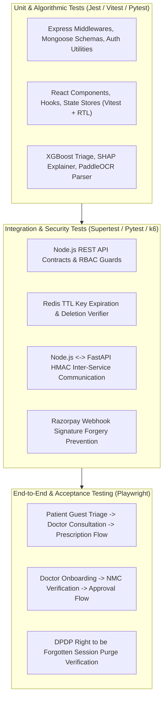

# HealthMate AI - Master Testing & Quality Assurance Strategy
**Document Version:** 1.0.0  
**Phase:** Phase 0 - Master Architecture, Requirements Analysis & Development Planning  
**Coverage Standard:** Minimum 85% Code Coverage, Zero Fabricated Data, Strict DPDP Verification  

---

## 1. Testing Pyramid & Verification Framework

HealthMate AI enforces a multi-tier testing framework across frontend, backend, AI microservice, and ephemeral data layers:



---

## 2. Layer-by-Layer Testing Specifications

### 2.1 Backend Unit & Integration Testing (Jest & Supertest)
- **Authentication & RBAC:**
  - Verify password hashing with argon2/bcrypt prevents plaintext storage.
  - Test JWT expiration (15m) and refresh token rotation.
  - Test unauthorized role access (e.g., Patient requesting `/api/v1/admin/*` returns HTTP 403 Forbidden).
- **Ephemeral Session Verification:**
  - Test guest session creation writes solely to Redis with `EXPIRE` set.
  - Verify that MongoDB collections (`users`, `appointments`) have 0 document count during guest triage.
  - Trigger `DELETE /patient/session/:id` and assert `redis.exists(key)` returns `0`.
- **Razorpay Webhook Verification:**
  - Generate valid HMAC signatures and verify appointment status updates to `CONFIRMED`.
  - Send forged or tampered webhook signatures and verify HTTP 400 rejection and security audit log generation.

---

### 2.2 Machine Learning & AI Model Validation (Pytest & MLflow)
- **Predictive Performance Benchmarks:**
  - Evaluate XGBoost triage model against holdout test set:
    - ROC-AUC > 0.85
    - Precision > 0.80
    - Recall (Emergency Class) > 0.95 (Safety-critical constraint)
- **Explainability (SHAP) Consistency:**
  - Test that top SHAP feature attributions correspond to known clinical risk factors (e.g., high systolic BP increases cardiovascular risk).
- **OCR Accuracy Benchmark:**
  - Run PaddleOCR against annotated Indian laboratory report test sets:
    - Character Error Rate (CER) < 3%
    - Biomarker value extraction F1 > 0.92
- **Data Drift Detection:**
  - Simulate feature distribution shifts using synthetic perturbation and assert that Kolmogorov-Smirnov test flags drift alert when p < 0.05.

---

### 2.3 Ephemeral Storage & DPDP Compliance Verification
A dedicated automated test suite validates the "Zero-Trust Patient Privacy" mandate:
```javascript
// Example Test: DPDP Ephemeral Purge Verification
describe("DPDP Ephemeral Storage & Purge Verification", () => {
  it("should completely purge temporary patient triage context upon request", async () => {
    const sessionRes = await request(app).post("/api/v1/patient/session/init");
    const sessionId = sessionRes.body.sessionId;

    // Post symptoms and lab data
    await request(app)
      .post("/api/v1/patient/symptom-check")
      .set("X-Session-ID", sessionId)
      .send({ symptoms: ["fever", "cough"], duration: "2 days" });

    // Assert data exists in Redis
    const redisDataBefore = await redisClient.get(`session:guest:${sessionId}`);
    expect(redisDataBefore).not.toBeNull();

    // Trigger instant purge
    const deleteRes = await request(app).delete(`/api/v1/patient/session/${sessionId}`);
    expect(deleteRes.status).toBe(200);

    // Assert 100% data eviction from Redis
    const redisDataAfter = await redisClient.get(`session:guest:${sessionId}`);
    expect(redisDataAfter).toBeNull();

    // Assert zero records in MongoDB
    const mongoCount = await PatientRecordModel.countDocuments({ sessionId });
    expect(mongoCount).toBe(0);
  });
});
```

---

### 2.4 WebRTC & Real-Time Media Testing
- **Signaling Server Tests:** Test Socket.IO room dispatch, authentication handshake, and disconnect cleanup.
- **ICE Candidate Exchange:** Simulate STUN/TURN fallback under simulated symmetric NAT network conditions.
- **Media Encryption:** Validate DTLS-SRTP key exchange over simulated WebRTC calls.

---

### 2.5 Load & Performance Testing (k6)
- **Target Metrics:**
  - 1,000 concurrent guest triage queries: P95 response time < 350ms.
  - 200 concurrent WebRTC signaling handshakes: zero packet loss.
  - Redis memory footprint: Stable under auto-eviction policy.
