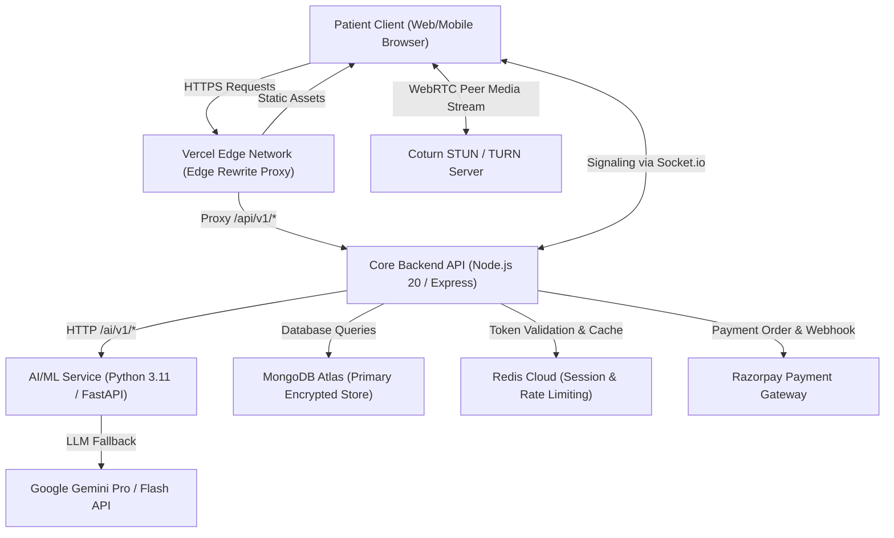
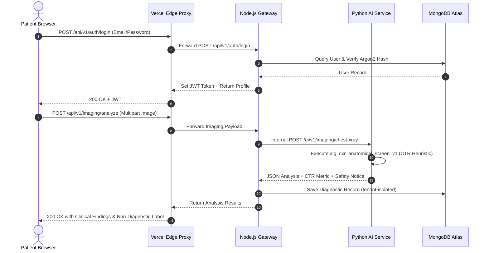
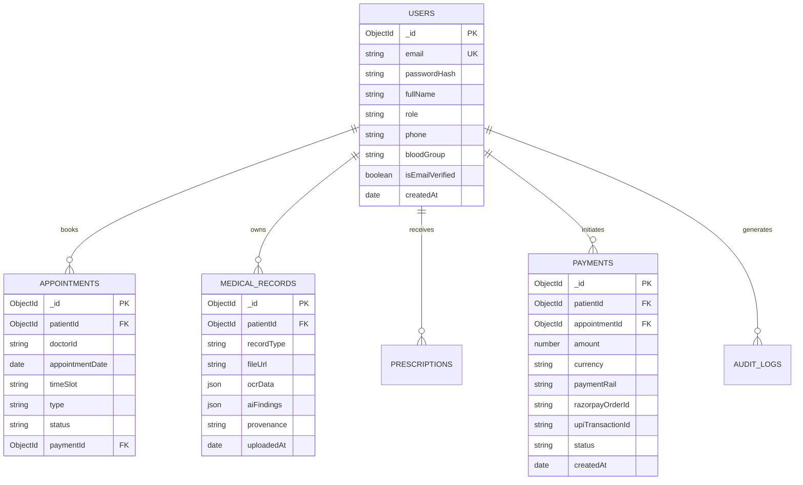

# HealthMate AI — Master System Architecture

> **Architecture Style:** Distributed Cloud Microservices with Edge API Gateway  
> **Frontend:** React 18 / Vite SPA deployed on Vercel Edge Network  
> **Backend API:** Node.js 20 / Express Enterprise API deployed on Render  
> **AI/ML Service:** Python 3.11 / FastAPI Inference Engine deployed on Render  
> **Data Layer:** MongoDB Atlas (Primary Datastore) + Redis Cloud (Cache & Rate Limiting)  

---

## 1. System Topology Overview

HealthMate AI is architected as an edge-accelerated, microservices-based clinical platform. Client requests from web browsers are ingested through the **Vercel Edge Network**, which routes frontend traffic directly to client-side bundles and dynamically proxies backend API requests (`/api/v1/*`) to the core Node.js API Gateway running on Render.

---

## 2. Component Architecture & Technology Matrix

### 2.1 Frontend Client (Vercel Edge)
- **Framework:** React 18 with Vite build tooling
- **Styling:** Tailwind CSS + Lucide Icons + Framer Motion
- **State Management:** React Context API + Local Storage Session Tokens
- **Routing:** React Router v6 with strict Protected Route guards (`/auth/*` vs `/patient/*`)
- **WebRTC Client:** Native HTML5 `getUserMedia`, `RTCPeerConnection`, and Socket.io client for real-time video signaling
- **Network Resilience:** Automatic `/api/v1` base URL routing through Vercel Edge Proxy, eliminating cross-origin preflight bottlenecks and regional ISP connection drops.

### 2.2 Core Backend Gateway (Node.js 20 / Express)
- **Role:** Authentication, business logic, RBAC enforcement, data persistence, payment orchestration, and WebRTC signaling.
- **Port:** `5001` (local) / `443` (production)
- **Security Middleware:** Helmet, CORS with whitelist validation, express-rate-limit, Argon2 password hashing, and jsonwebtoken (JWT) signed access tokens.
- **Socket.io Service:** Real-time bi-directional signaling for WebRTC peer exchange, ICE candidate negotiation, and consultation state transitions.

### 2.3 AI/ML Microservice (Python 3.11 / FastAPI)
- **Role:** Medical imaging analysis, ECG digital signal processing, pathology lab OCR, and clinical symptom triage.
- **Port:** `8000` (local) / `443` (production)
- **Core Libraries:** FastAPI, Uvicorn, NumPy, SciPy, OpenCV (`cv2`), PyTesseract, Pydantic v2.
- **Concurrency:** Asynchronous non-blocking endpoints with thread-pool offloading for CPU-bound image and signal transforms.

---

## 3. Communication Protocols & Data Flow

---

## 4. Master Database Architecture (MongoDB Atlas)

The primary datastore organizes clinical healthcare domain entities into collections with tenant isolation enforced at the schema and query levels:

---

## 5. Caching & Session Architecture (Redis Cloud)

HealthMate AI utilizes Redis Cloud for high-throughput, transient state caching:
1. **OTP Rate Limiting & Verification:** 6-digit verification codes stored with a strict **5-minute TTL** (`otp:{email}`). Prevents replay attacks and brute-force enumeration.
2. **Revocation Blacklist:** JWT access tokens invalidated during logout are added to an in-memory blacklist until token expiration.
3. **Doctor Discovery Cache:** Frequently queried practitioner listings cached with a **1-hour TTL** to minimize expensive spatial and fuzzy-text queries on MongoDB.
