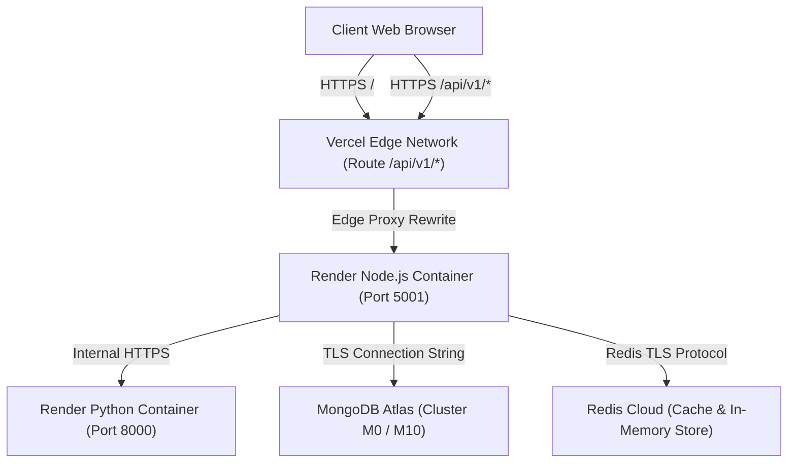

# HealthMate AI — Cloud Deployment & Infrastructure Topology

> **Production Frontend:** [https://healthmate-ai-nine-mocha.vercel.app](https://healthmate-ai-nine-mocha.vercel.app)  
> **Backend Microservice:** [https://healthmate-backend-9nmm.onrender.com](https://healthmate-backend-9nmm.onrender.com)  
> **AI/ML Microservice:** [https://healthmate-ai-service.onrender.com](https://healthmate-ai-service.onrender.com)  
> **Architecture:** Edge Reverse Proxy (Vercel) + Dual Render Containers + MongoDB Atlas + Redis Cloud  

---

## 1. Cloud Infrastructure Architecture



### 1.1 Vercel Edge API Proxy (`vercel.json`)
To eliminate connection timeouts caused by regional ISP egress barriers and CORS preflight latency, the frontend client issues API requests to `/api/v1/*`. Vercel's edge network proxies these requests directly to the Render backend:
```json
{
  "rewrites": [
    {
      "source": "/api/v1/:path*",
      "destination": "https://healthmate-backend-9nmm.onrender.com/api/v1/:path*"
    },
    {
      "source": "/(.*)",
      "destination": "/index.html"
    }
  ]
}
```

---

## 2. Local Development Setup (macOS / Linux)

### 2.1 Prerequisites
- **Node.js:** v20.x or higher (`node -v`)
- **Python:** v3.11.x (`python3 --version`)
- **System Dependencies (OCR):** Tesseract OCR
  - macOS: `brew install tesseract`
  - Ubuntu/Debian: `sudo apt-get install tesseract-ocr libtesseract-dev`
- **MongoDB & Redis:** Local instances or free cloud connection strings (MongoDB Atlas + Redis Cloud)

### 2.2 Step 1: Clone Repository
```bash
git clone https://github.com/Abhishek4-ui/HEALTHMATEAI.git
cd HEALTHMATEAI
```

### 2.3 Step 2: Configure Environment Variables
Copy sample environment files:
```bash
cp .env.example .env
cp backend/.env.template backend/.env
cp ai-service/.env.template ai-service/.env
cp frontend/.env.template frontend/.env.local
```

#### Root & Backend Configuration (`backend/.env`):
```ini
PORT=5001
NODE_ENV=development
CLIENT_URL=http://localhost:5173
MONGODB_URI=mongodb+srv://<user>:<password>@cluster0.mongodb.net/healthmate?retryWrites=true&w=majority
JWT_SECRET=your_super_secret_jwt_key_at_least_32_chars_long
JWT_EXPIRES_IN=7d
REDIS_URL=redis://default:<password>@<host>:<port>
AI_SERVICE_URL=http://localhost:8000
RAZORPAY_KEY_ID=rzp_test_yourKeyId
RAZORPAY_KEY_SECRET=yourRazorpaySecret
EMAIL_SERVICE_API_KEY=your_resend_or_sendgrid_key
```

#### AI Microservice Configuration (`ai-service/.env`):
```ini
PORT=8000
HOST=0.0.0.0
ENVIRONMENT=development
GEMINI_API_KEY=your_gemini_api_key
CORS_ORIGINS=http://localhost:5173,http://localhost:5001
```

#### Frontend Configuration (`frontend/.env.local`):
```ini
VITE_API_BASE_URL=http://localhost:5001/api/v1
VITE_RAZORPAY_KEY_ID=rzp_test_yourKeyId
```

### 2.4 Step 3: Install Dependencies & Run

#### Backend (Terminal 1):
```bash
cd backend
npm install
npm run dev
```

#### AI Service (Terminal 2):
```bash
cd ai-service
python3 -m venv venv
source venv/bin/activate
pip install -r requirements.txt
uvicorn app.main:app --host 0.0.0.0 --port 8000 --reload
```

#### Frontend (Terminal 3):
```bash
cd frontend
npm install
npm run dev
```

---

## 3. Production Deployment Commands

### 3.1 Vercel Frontend Deployment
- **Root Directory:** `frontend`
- **Build Command:** `npm run build`
- **Output Directory:** `dist`
- **Environment Variables:**
  - `VITE_API_BASE_URL`: `/api/v1` *(enables Vercel Edge Proxy)*
  - `VITE_RAZORPAY_KEY_ID`: `rzp_test_...`

### 3.2 Render Backend Deployment
- **Environment:** `Node`
- **Build Command:** `npm install`
- **Start Command:** `node server.js`
- **Health Check Path:** `/api/v1/health`

### 3.3 Render AI Service Deployment
- **Environment:** `Python 3`
- **Build Command:** `pip install -r requirements.txt`
- **Start Command:** `uvicorn app.main:app --host 0.0.0.0 --port 8000`
- **Health Check Path:** `/health`
