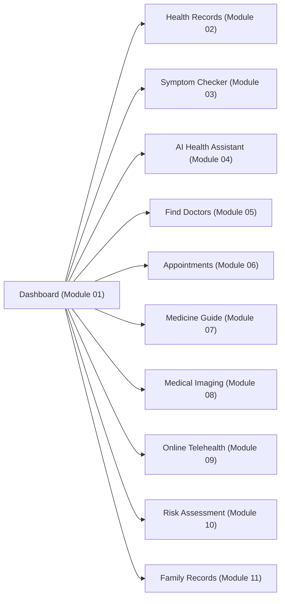

# HealthMate AI — Feature Specification & Module Compendium

> **Scope:** Patient Healthcare Ecosystem (11 Production Modules)  
> **Target Demographic:** Registered Patients and Family Caregivers  
> **Production Status:** 100% Deployed & Active on Vercel  

---

## 1. Complete Patient Platform Modules

HealthMate AI is organized into 11 specialized patient-facing modules accessible from the unified patient dashboard navigation:

---

## 2. Module-by-Module Technical Inventory

### Module 01: Patient Central Dashboard
- **Unified Health Summary:** Displays upcoming appointments, recent lab results, active medication schedules, and clinical quick actions.
- **Doctor Name Normalization:** Automatic formatting to prevent redundant honorific prefixes (e.g. `Dr. Dr.` normalization).
- **Zero Dummy Data Empty States:** When no patient data is logged, graceful guidance cards encourage uploading medical records or scheduling preventive checkups.

### Module 02: Health Records & Document Vault
- **Encrypted Document Storage:** Multi-format file upload support (PDF, PNG, JPG, DICOM preview).
- **Tenant-Isolated Multi-Tenancy:** Patient documents are strictly bound to `patientId` with database query filters preventing cross-tenant access.
- **Universal Camera Integration:** Direct client-side hardware camera preview, frame capture, dimensions verification (1280x720 / 1920x1080), retake, and canvas handoff to the upload pipeline.
- **Automated Pathology Lab OCR:** Tesseract + OpenCV pipeline extracting lab biomarkers (Hemoglobin, Platelets, Fasting Glucose, Serum Creatinine) with LOINC range mapping.

### Module 03: Symptom Checker & Emergency Triage
- **Bayesian Clinical Heuristics:** Evaluates acute symptom clusters with emergency red-flag triggers.
- **Mandatory Safety Notice:** Prominent emergency triage warning banner rendering national emergency call buttons (112 National Emergency, 102 Ambulance) prior to submission.
- **Epistemic Uncertainty Filter:** Rejects non-medical and ambiguous inputs using Shannon entropy calculations ($H > 1.800$), returning safe escalation guidance.

### Module 04: Multi-Lingual AI Health Assistant
- **Bilingual Conversational Interface:** Native English and Hindi (`hi-IN`) conversational support.
- **Clinical Guardrails:** Strictly disclaims diagnostic authority; offers preventive lifestyle guidance, symptom clarification, and specialist recommendation.
- **Multi-Modal Context:** Ingests patient-uploaded reports into the conversational context for personalized explanations.

### Module 05: Find Doctors (Pan-India Discovery)
- **36 Indian States & UTs:** Broad geographical coverage covering major metropolitan and regional medical centers across India.
- **Specialty Filtering:** General Medicine, Cardiology, Neurology, Pediatrics, Orthopedics, Dermatology, Gynecology, and Oncology.
- **Verified Credentials:** NMC registration number verification badges and hospital affiliations.

### Module 06: Appointment Booking & Scheduling
- **Real-Time Slot Reservation:** Conflict-free calendar slot selection with atomic database locking.
- **Consultation Modalities:** In-clinic physical visits and remote video consultations.
- **Rescheduling & Cancellation:** Instant appointment status updates with cancellation workflows.

### Module 07: Medicine Information & Drug Interactions
- **Comprehensive Drug Compendium:** Dosage guidelines, side effect warnings, mechanisms of action, and food contraindications.
- **Multi-Drug Interaction Screening:** Evaluates concurrent medications for adverse drug-drug interactions (DDIs).
- **Medication Reminders:** Patient dosage scheduling with timing tags (Morning, Afternoon, Evening).

### Module 08: Medical Imaging & Diagnostics
- **Chest X-Ray Screening (`alg_cxr_anatomical_screen_v1`):** Deterministic lung field segmentation and cardiothoracic ratio (CTR) calculation to identify potential cardiomegaly. Labeled as an experimental non-diagnostic prototype.
- **Brain MRI Triage (`alg_mri_gradient_triage_v1`):** Sobel gradient edge analysis, hemispheric symmetry variance, and signal-to-noise ratio (SNR) quality assessment. Labeled as experimental non-diagnostic triage.
- **Cardiac ECG Waveform DSP (`mdl_ecg_lead12_waveform_v2`):** Pan-Tompkins QRS peak localization, heart rate calculation, and Lead II rhythm-strip signal processing evaluated on PhysioNet PTB-XL datasets.

### Module 09: Online Telehealth & Video Consultation
- **WebRTC Peer-to-Peer Video:** High-definition video and audio streaming with low latency.
- **In-Call Controls:** Real-time microphone mute, camera toggle, and call termination.
- **Consultation Summary Generation:** Automated post-consultation clinical summary download in Markdown format.

### Module 10: Chronic Disease Risk Assessment
- **Cardiovascular Risk (Framingham / WHO score):** Calculates 10-year risk percentages based on blood pressure, cholesterol, smoking history, and BMI.
- **Type 2 Diabetes Risk (IDRS / ADA score):** Age, physical activity, waist circumference, and family history risk stratification.
- **Actionable Lifestyle Recommendations:** Tailored dietary and physical activity interventions based on risk tier.

### Module 11: Family Health Records
- **Dependent Profiles:** Manage health records for parents, spouses, and children under a single patient umbrella account.
- **Shared Access Controls:** Granular record-sharing permissions between family members.
- **Vaccination & Growth Tracking:** Pediatric immunization schedules and growth milestones.
