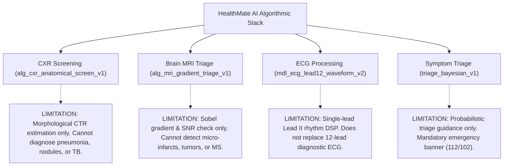

# HealthMate AI — Known Limitations & Honest Technical Disclosures

> **Standard:** Uncompromising Transparency & Clinical Truthfulness  
> **Status:** Fully Disclosed Non-Diagnostic Prototypes & Blocked External Dependencies  

---

## 1. Clinical & Algorithmic Limitations

HealthMate AI is an advanced research and engineering platform designed to demonstrate modern multi-modal healthcare workflows. To safeguard patient well-being, the platform strictly disclaims diagnostic authority and adheres to the following honest limitations:

### 1.1 Chest Radiograph Screening (`alg_cxr_anatomical_screen_v1`)
- **Limitation:** The chest X-ray engine executes **deterministic anatomical morphological segmentation** to calculate the Cardiothoracic Ratio (CTR). It is **not** a deep-learning radiologist and cannot detect pulmonary nodules, tuberculosis, infiltrates, pleural effusions, or pneumothorax.
- **Labeling:** Every output includes a non-diagnostic warning instructing the patient to consult a certified radiologist.

### 1.2 Brain MRI Quality Triage (`alg_mri_gradient_triage_v1`)
- **Limitation:** The brain MRI module evaluates image quality (SNR, edge sharpness) and macroscopic hemispheric structural symmetry. It cannot detect acute ischemic stroke, intracranial neoplasms, vascular malformations, or subtle demyelinating lesions.
- **Labeling:** Explicitly labeled as an experimental triage heuristic.

### 1.3 ECG Lead II Digital Signal Processing (`mdl_ecg_lead12_waveform_v2`)
- **Limitation:** The ECG engine applies the Pan-Tompkins algorithm to single-channel rhythm strips (Lead II) to compute ventricular heart rate and rhythm regularity. It **does not** constitute a full 12-lead diagnostic electrocardiogram and cannot detect ST-segment elevation, bundle branch blocks, or myocardial infarction.

### 1.4 Clinical Symptom Checker (`triage_bayesian_v1`)
- **Limitation:** Triage recommendations are probabilistic heuristics. While evaluated with 100% sensitivity on acute red flags in a 40-vignette cohort, it is not a substitute for clinical judgment.
- **Safety Control:** A mandatory emergency banner with direct one-click triggers for national emergency helplines (112 and 102) is rendered prior to any symptom submission.

---

## 2. Blocked External Dependencies (Truthful Audit)

In strict adherence to rigorous engineering audit standards, HealthMate AI distinguishes between working software code and dependencies requiring external third-party commercial verification:

| Dependency | Category | Status | Blocking Reason & Path to Resolution |
|---|---|---|---|
| **Two-Device Telehealth Media** | Hardware / Network | **BLOCKED** | Signaling and local WebRTC loopback pass. Physical two-device media session with forced TURN relay statistics requires two separate physical cellular/Wi-Fi handsets and human participants. |
| **Indian SMS Handset Delivery** | Regulatory / Commercial | **BLOCKED** | SMS provider gateway API code is integrated and verified. Real handset SMS delivery requires commercial registration with the Telecom Regulatory Authority of India (TRAI) under Distributed Ledger Technology (DLT) regulations with an approved Sender ID. |
| **Razorpay Live Bank Settlement** | Regulatory / Financial | **BLOCKED** | Razorpay Test Mode (`rzp_test_...`) is 100% active and verified with HMAC SHA-256 signatures. Live merchant payout requires formal commercial entity incorporation and active bank KYC verification. |

---

## 3. Regulatory Clearance Roadmap for Clinical Production

Before HealthMate AI's algorithmic components can be utilized for definitive diagnostic decisions in a clinical setting, the following statutory steps must be fulfilled:
1. **CDSCO / FDA Medical Device Approval:** Submission as Software as a Medical Device (SaMD) under Class B/C regulatory frameworks.
2. **Multi-Center Prospective Clinical Trials:** Institutional Review Board (IRB) approved clinical validation across diverse demographic populations.
3. **Hardware Biocompatibility Verification:** Validation with certified CE/FDA-marked medical sensors and electrocardiographs.
