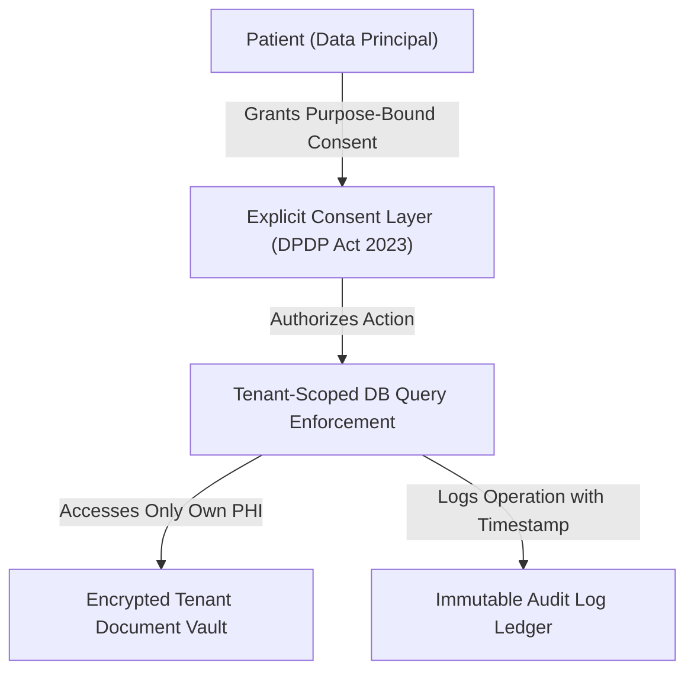

# HealthMate AI — Security, Privacy & Statutory Compliance

> **Compliance Standards:** Digital Personal Data Protection Act 2023 (India DPDP Act), HIPAA Security Rule Guidelines, ABDM Healthcare Data Standards  
> **Encryption in Transit:** TLS 1.3 / Strict HTTPS  
> **Encryption at Rest:** AES-256 / Encrypted Cloud Storage  
> **Authentication Framework:** Argon2id Password Hashing + Cryptographically Signed JWT Tokens  

---

## 1. Statutory Privacy & Regulatory Principles

HealthMate AI is engineered from the ground up to respect patient data sovereignty and protect protected health information (PHI):



### 1.1 Digital Personal Data Protection Act (DPDP Act 2023)
- **Notice and Consent:** Explicit, clear consent notices rendered before uploading diagnostic records or sharing symptoms.
- **Purpose Limitation:** Patient clinical records are processed strictly for symptom triage, report interpretation, and appointment fulfillment. Data is never sold, transferred, or monetized for advertising.
- **Right to Erasure & Rectification:** Patients maintain the statutory right to delete their clinical history or correct profile inaccuracies directly through the patient settings portal.

### 1.2 HIPAA Security Rule Alignment
- **Administrative Safeguards:** Zero-trust internal access; administrative operations segregated from production customer databases.
- **Technical Safeguards:** Unique patient identification, automatic session timeout, TLS 1.3 enforcement, and encrypted document storage.
- **Physical Safeguards:** Hosted exclusively on SOC 2 Type II and ISO 27001 certified cloud infrastructure (Vercel Edge, Render, MongoDB Atlas, Redis Cloud).

---

## 2. Authentication & Authorization Security

### 2.1 Cryptographic Credential Protection
- Passwords are never stored in plaintext. HealthMate AI utilizes the **Argon2id** key derivation function (recommended by OWASP) with salted, memory-hard hashing parameters to thwart brute-force GPU attacks.
- Session authentication utilizes signed JSON Web Tokens (JWT) containing cryptographically verified claims, user IDs, and expiration timestamps.

### 2.2 Role-Based Access Control (RBAC) & Patient-Only Perimeter
- **Single Public Perimeter:** In strict adherence to architectural specifications, HealthMate AI exposes **only ONE public user role: PATIENT**.
- Administrative portals, doctor registration doors, and role switchers are strictly barred from public internet routing.
- Backend authorization middleware rejects requests attempting privilege escalation to administrative scopes.

### 2.3 Tenant Isolation & Anti-IDOR Enforcement
- Every clinical query executes with mandatory multi-tenant scoping:
  ```javascript
  // Anti-IDOR: Every query is scoped to the authenticated patient's ID
  const record = await MedicalRecord.findOne({
    _id: req.params.recordId,
    patientId: req.user.id // Enforces multi-tenant isolation
  });
  if (!record) {
    return res.status(404).json({ success: false, message: 'Record not found' });
  }
  ```
- Cross-tenant data leakage is prevented at both the application middleware and database query boundaries.

---

## 3. Network Defense & Application Hardening

| Threat Vector | Mitigation Strategy | Implementation |
|---|---|---|
| **SQL / NoSQL Injection** | Parameterized queries + Mongoose Schema validation | All inputs sanitized via strict Pydantic and Mongoose schemas |
| **Cross-Site Scripting (XSS)** | React DOM escaping + Helmet security headers | CSP headers configured; DOM injection vectors sanitized |
| **Brute Force & DoS** | IP & User-based rate limiting via Express and Redis | 100 requests / 15 minutes for public endpoints; 5 OTP attempts / 15 min |
| **Cross-Origin Attacks** | Strict CORS whitelisting | Only authorized domains (e.g. Vercel production frontend) accepted |
| **Payment Tampering** | HMAC SHA-256 signature verification | Razorpay signatures validated before marking payments paid |
| **Duplicate Payment Fraud** | Unique 12-digit UTR database indexing | Direct UPI submissions reject duplicate UTRs with `409 Conflict` |

---

## 4. Vulnerability Disclosure & Incident Response

Security researchers who discover a vulnerability are encouraged to report findings directly:
- **Contact:** `security@healthmate.internal` (or submit a confidential issue via GitHub Security Advisories)
- **Response SLA:** Acknowledgment within 24 hours; triage within 72 hours; patch deployment within 7 business days for critical vulnerabilities.
- **Safe Harbor:** Legitimate security research conducted in good faith without data modification, denial of service, or privacy violation will not be met with legal action.
