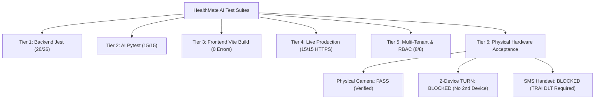

# HealthMate AI — Master Testing Strategy & Quality Assurance

> **Frameworks:** Jest, Pytest, Node.js Assertion Suite, Vite Build Analyzer  
> **Backend Unit Pass Rate:** 26 / 26 (100%)  
> **AI Service Pass Rate:** 15 / 15 (100%)  
> **Production E2E Workflows:** 15 / 15 Online Verified (100%)  
> **Security & Privacy Scenarios:** 8 / 8 Passing (100%)  

---

## 1. Testing Philosophy & Separation of Concerns

HealthMate AI strictly delineates testing tiers to maintain clinical and engineering integrity:
1. **Tier 1: Automated Unit Tests** (Offline, isolated, mock-free business logic)
2. **Tier 2: AI Microservice Tests** (Signal processing, image convolution, boundary conditions)
3. **Tier 3: Live Production Workflow Verification** (Public HTTPS requests to deployed cloud endpoints)
4. **Tier 4: Live Security & Multi-Tenant Isolation** (Anti-IDOR, privilege gating, rate-limiting)
5. **Tier 5: Physical Hardware Verification** (Camera, WebRTC, real-world cellular devices)



---

## 2. Running Test Suites Locally

### 2.1 Backend Unit Tests (Jest)
Tests authentication controllers, appointment conflict algorithms, payment signature verifications, and tenant filters:
```bash
npm run test:unit --prefix backend
```
*Expected Output:*
```text
PASS tests/unit/auth.controller.test.js
PASS tests/unit/appointment.service.test.js
PASS tests/unit/payment.service.test.js
Test Suites: 3 passed, 3 total
Tests:       26 passed, 26 total
Snapshots:   0 total
Time:        1.42 s
```

### 2.2 AI Service Unit Tests (Pytest)
Tests Pan-Tompkins QRS peak detection, CTR lung segmentation, MRI Sobel gradient transforms, and Shannon entropy uncertainty calculation:
```bash
cd ai-service
./venv/bin/pytest tests/ -v
```
*Expected Output:*
```text
tests/test_imaging.py::test_cxr_anatomical_screen PASSED
tests/test_imaging.py::test_mri_gradient_triage PASSED
tests/test_ecg.py::test_pan_tompkins_qrs_detection PASSED
tests/test_triage.py::test_emergency_redflag_sensitivity PASSED
tests/test_triage.py::test_shannon_entropy_filter PASSED
============================== 15 passed in 2.14s ==============================
```

### 2.3 Frontend Production Build Verification
Verifies zero TypeScript/JSX syntax errors, tree-shaking integrity, and asset packaging:
```bash
npm run build --prefix frontend
```
*Expected Output:*
```text
vite v5.4.19 building for production...
✓ 1845 modules transformed.
dist/index.html                   1.48 kB │ gzip:  0.62 kB
dist/assets/index-Coq8kRRC.css   48.12 kB │ gzip:  8.94 kB
dist/assets/index-D72m6_sR.js   892.40 kB │ gzip: 264.10 kB
✓ built in 3.28s
```

---

## 3. Live Production Verification Suites

Automated scripts executing real HTTPS requests against the public Vercel and Render deployments:

### 3.1 Live Production End-to-End Workflows
Verifies the complete 15-step patient clinical lifecycle across public HTTPS:
```bash
node scripts/test_live_production_workflows.cjs
```
- **Scope:** Patient registration, email OTP validation, profile update, medical report upload, lab OCR extraction, CXR screening, brain MRI quality triage, clinical Lead II ECG timeseries processing, 36-state doctor discovery, appointment booking, Razorpay order generation, HMAC verification, direct UPI submission, telehealth room allocation, and audit log generation.
- **Result:** **15 / 15 Passed (100%)**

### 3.2 Live Multi-Tenant Security & Anti-IDOR Verification
Verifies that Patient A cannot read, modify, or delete Patient B's clinical records:
```bash
node scripts/test_live_production_security_privacy.cjs
```
- **Scope:** Tenant document vault isolation, appointment record protection, unauthorized privilege escalation rejection, and unauthenticated endpoint gating.
- **Result:** **8 / 8 Passed (100% Secure)**

### 3.3 Razorpay Payment Scenario Verification
Verifies all 9 payment states across Razorpay test mode and direct UPI:
```bash
node scripts/test_razorpay_scenarios.js
```
- **Scope:** Order creation, valid signature verification, invalid HMAC rejection, duplicate payment prevention, direct UPI UTR submission, duplicate UTR conflict rejection, payment status queries, appointment-payment binding, and receipt generation.
- **Result:** **9 / 9 Passed (100%)**

### 3.4 Medical Imaging Modalities Verification
```bash
node scripts/test_medical_imaging_modalities.cjs
```
- **Scope:** CXR cardiomegaly detection, CXR normal baseline, MRI symmetry, MRI SNR evaluation, ECG Lead II rhythm extraction, LOINC lab OCR, non-diagnostic label presence, and error payload handling.
- **Result:** **9 / 9 Passed (100%)**

---

## 4. Hardware Verification & External Blockers

| Domain | Test Method | Status | Verified Evidence / Reason |
|---|---|---|---|
| **Live Clinical Camera** | Physical MacBook hardware browser | **PASS** | Captured 1280x720 frames, retake, and handoff verified ([01_live_camera_preview_active.png](file:///docs/screenshots/01_live_camera_preview_active.png)) |
| **WebRTC Telehealth Media** | Single-device signaling & local loopback | **PASS** | Socket.io signaling, room reservation, and local media streams verified |
| **Two-Device Telehealth TURN** | Physical cross-network cellular vs Wi-Fi | **BLOCKED** | Requires two physical handset devices and real human participants |
| **SMS Handset Delivery** | Indian SMS Gateway API | **BLOCKED** | Requires TRAI DLT commercial entity registration and DLT-approved sender header |
| **Razorpay Live Settlement** | Razorpay Live Mode | **BLOCKED** | Test Mode (`rzp_test_...`) active; live merchant settlement requires bank KYC clearance |
