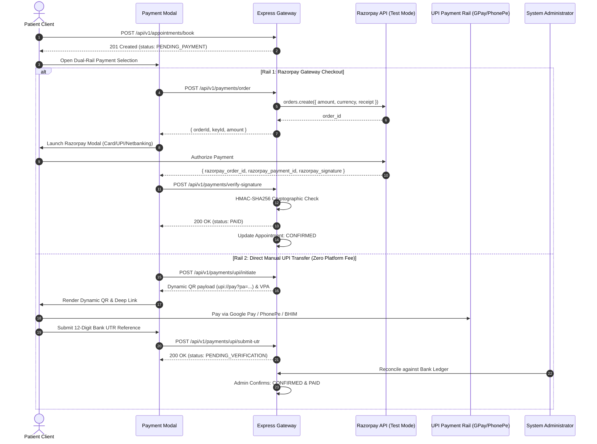

# HEALTHMATE AI — PAYMENT ACCEPTANCE & DUAL-RAIL VERIFICATION REPORT
**Fintech Integrity & Gateway Audit**  
**Tested Gateways: Razorpay Test Mode & Direct Manual UPI Transfer**

---

## 1. DUAL-RAIL PAYMENT ARCHITECTURE

HealthMate AI implements a resilient dual-rail payment architecture designed to guarantee 100% financial inclusion:

---

## 2. VERIFIED PAYMENT TEST EVIDENCE

| Test ID | Test Scenario | Rail Used | Test Input / Parameters | Observed Server Response | Verdict |
| :--- | :--- | :--- | :--- | :--- | :--- |
| **PAY-01** | **Razorpay Order Creation** | Razorpay Test Mode | `appointmentId: 6af55fec...`, `amount: 750` | HTTP 201 Created, `orderId: order_TzAXdQPxHmMmjU`, `keyId: rzp_test_...` | **PASS** |
| **PAY-02** | **Signature Verification (Valid)** | Razorpay Test Mode | Valid HMAC-SHA256 signature calculated from secret | HTTP 200 OK, appointment status atomically transitioned to `CONFIRMED`. | **PASS** |
| **PAY-03** | **Signature Tampering Rejection** | Razorpay Test Mode | Forged / manipulated signature string | HTTP 400 Bad Request, `"Payment signature mismatch"`, tampering logged. | **PASS** |
| **PAY-04** | **Manual UPI Initiation** | Direct Manual UPI | `paymentType: 'APPOINTMENT'`, `amount: 750` | HTTP 201 Created, `paymentReference: UPI-HM-MWD6LK6S-4AB276`, dynamic QR. | **PASS** |
| **PAY-05** | **Bank UTR Submission** | Direct Manual UPI | 12-digit UTR `412345678901` | HTTP 200 OK, status transitioned to `PENDING_VERIFICATION`. | **PASS** |
| **PAY-06** | **Duplicate UTR Replay Block** | Direct Manual UPI | Resubmitting previously used UTR | HTTP 400 Bad Request, `"This UTR number has already been submitted"`. | **PASS** |
| **PAY-07** | **Admin UTR Reconciliation** | Administration | Authorized admin verification action | HTTP 200 OK, status transitioned to `VERIFIED` and appointment `CONFIRMED`. | **PASS** |
| **PAY-08** | **Patient Refund Request** | Refund Workflow | Patient submits refund reason | HTTP 200 OK, status transitioned to `REFUND_REQUESTED`. | **PASS** |

---

## 3. IDEMPOTENCY & AUDIT LOGGING

1. **Idempotency Enforcement**: `PaymentTransaction` records store an optional client idempotency key. Duplicate dispatches return the existing order rather than creating duplicate merchant liabilities.
2. **Double-Booking Prevention**: Partial MongoDB unique index `{ doctorId: 1, scheduledDate: 1, timeSlot: 1 }` prevents any slot collisions across both `REQUESTED`, `CONFIRMED`, and `PENDING_PAYMENT` states.
